# Dashboard Guition — écran mural LVGL pour Home Assistant

[English](README.md) | **Français**

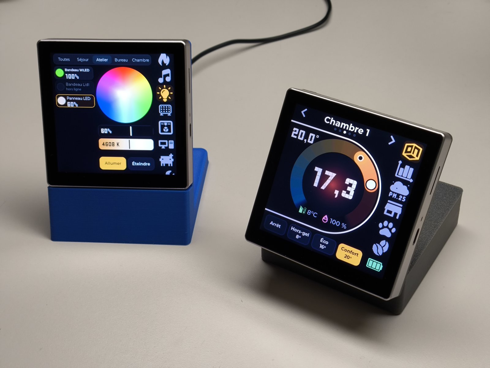

Tableau de bord mural pour écrans **Guition ESP32-S3-4848S040** : firmware LVGL 9.6, piloté par
**Home Assistant via MQTT**, avec un **simulateur PC** qui compile le vrai code des pages et produit des
captures 480 × 480. Dix-neuf pages tactiles pour la maison : chauffage, graphes 24 h, qualité de l'air,
ouvrants, croquettes, café, eau chaude, VMC, poêle à bois, musique, lumières, panneau LED, imprimante 3D,
PC, IA, réglages, informations, batterie et radar.

Il existe aussi en **version sans fil** (à droite sur la photo, sur son pivot) : batterie, radar de présence, veille
profonde à 2 mA — voir [Écran sur batterie](#écran-sur-batterie).

[](LICENSE)
[](lib/lvgl-9.6.0)
[](board/esp32-s3-devkitc-1-n16r8v.json)
[](platformio.ini)
[](CONTRAT_MQTT.md)

---

## Sommaire

- [Navigation](#navigation) · [Caméra en direct](#caméra-en-direct) · [Galerie](#galerie) · [Page « IA »](#page--ia-) · [Écran sur batterie](#écran-sur-batterie)
- [Matériel](#matériel) · [Architecture](#architecture) · [Sous le capot](#sous-le-capot) · [Démarrage rapide](#démarrage-rapide) · [Aller plus loin](#aller-plus-loin) · [Limites connues](#limites-connues) · [Licence et crédits](#licence-et-crédits)
- Pages détaillées : [Installation](docs/INSTALLATION.md) · [Sous le capot](docs/SOUS_LE_CAPOT.md) · [Imprimante 3D](docs/IMPRIMANTE.md) · [Développement](docs/DEVELOPPEMENT.md) · [Crédits](docs/CREDITS.md) · [Écran sur batterie](materiel/ecran-batterie/) · [Support 3D](materiel/support-bureau/)

## Navigation

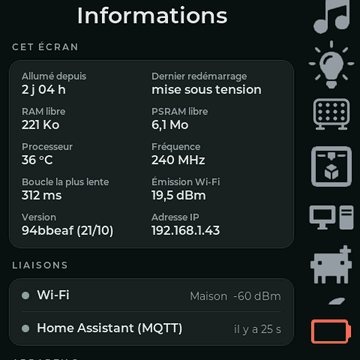

Le rail de droite est un **carrousel d'icônes** qui défile au doigt : 17 icônes de 64 px, sans
aimantation ni élastique, il s'arrête pile sur la première et la dernière. Un appui sur une icône
change la page d'un coup ; la page épinglée (ici la batterie) reste fixe en bas.

L'animation sort du simulateur, aux instants réels du geste : depuis la page Informations, le rail
glisse et s'arrête en haut, un appui ouvre le chauffage, puis un appui sur Confort fait balayer l'anneau
jusqu'à la consigne de 20°.

## Caméra en direct

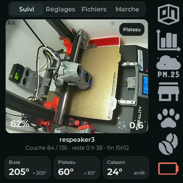

La page Imprimante 3D affiche les caméras de l'imprimante **en direct, image après image** (MJPEG via
go2rtc). Ici, un park complet de la tête, filmé par la caméra du caisson puis par celle du plateau ; les
images sont les vraies, enregistrées pendant le park, rejouées dans le simulateur à la cadence
**mesurée sur l'écran** :

| Caméra | Mesuré sur l'écran | Réglage de la source |
|---|---|---|
| Caisson (thingino, sous-flux 640 × 360) | ≈ 18,7 images/s | 20 images/s |
| Plateau (crowsnest) | ≈ 14,4 images/s | 15 images/s |

L'écran suit ce que la source envoie : c'est le réglage de la caméra qui fixe la cadence. Pendant que
le rail bouge, le flux se met en pause et repart 300 ms après l'arrêt (sinon la caméra hacherait le
geste). Configurer une imprimante Klipper/Moonraker : [docs/IMPRIMANTE.md](docs/IMPRIMANTE.md).

## Galerie

Rendu réel du code, capturé par le simulateur (`make -C simu`). Les valeurs chiffrées y sont dans la
police pixel « 3x5 » de K-Type, une **option** à télécharger soi-même (usage personnel) ; par défaut, le
firmware les affiche en Montserrat Bold — voir [tools/fonts/README.md](tools/fonts/README.md#option--la-police-pixel--3x5--des-captures).

<table>
  <tr>
    <td width="33%" valign="top">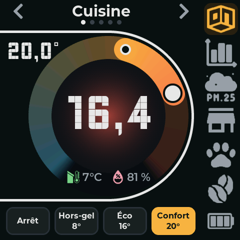<br><b>Chauffage</b> — température mesurée, consigne à l'anneau, lueur de chauffe, modes</td>
    <td width="33%" valign="top">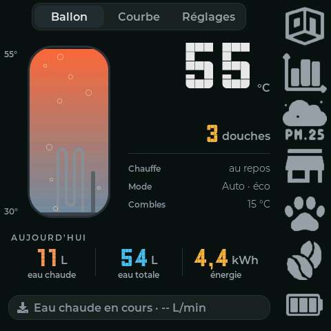<br><b>Eau chaude</b> — ballon, consigne à l'anneau, chauffe forcée, courbe 24 h</td>
    <td width="33%" valign="top">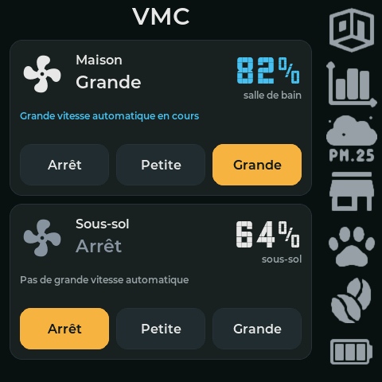<br><b>VMC</b> — vitesse par zone, hygrométrie en direct, hélices animées</td>
  </tr>
  <tr>
    <td width="33%" valign="top">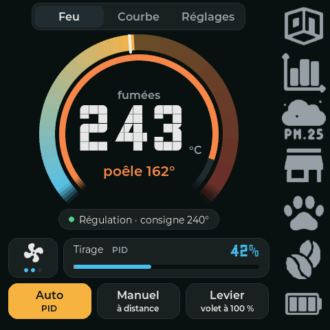<br><b>Poêle à bois</b> — tirage régulé sur la température des fumées, alerte recharge, courbes</td>
    <td width="33%" valign="top">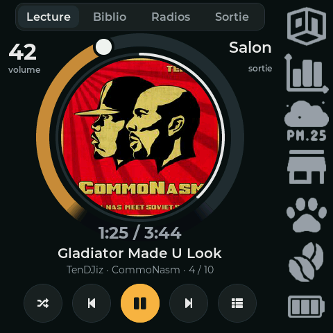<br><b>Musique</b> — Music Assistant : lecture, bibliothèque, albums, radios, sortie</td>
    <td width="33%" valign="top">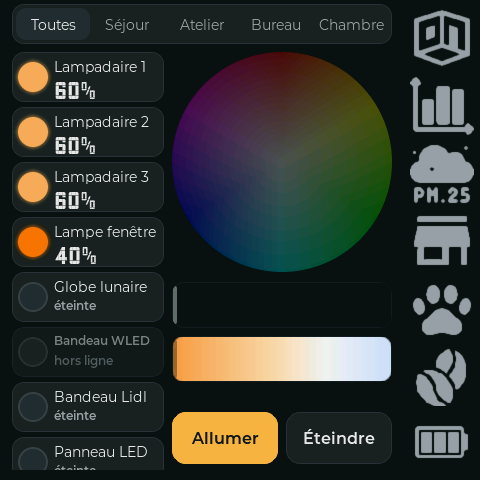<br><b>Lumières</b> — une lampe sélectionnée, couleur choisie sur le disque, luminosité au doigt</td>
  </tr>
  <tr>
    <td width="33%" valign="top">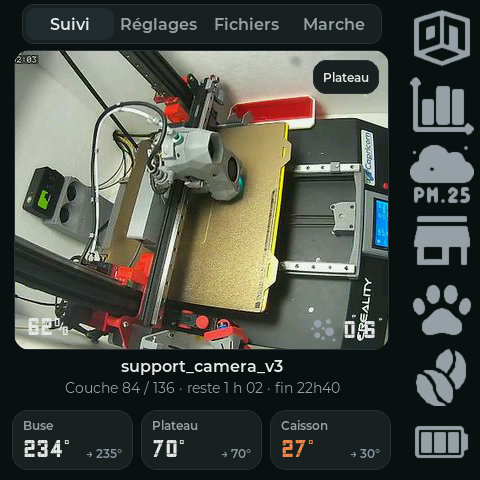<br><b>Imprimante 3D</b> — fichiers et miniatures, suivi de la couche en cours, caméras en direct</td>
    <td width="33%" valign="top">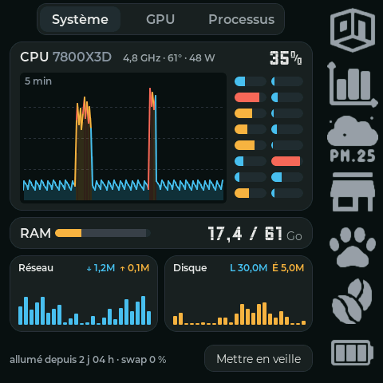<br><b>PC</b> — système, GPU, processus, IA locale, mise en veille</td>
    <td width="33%" valign="top">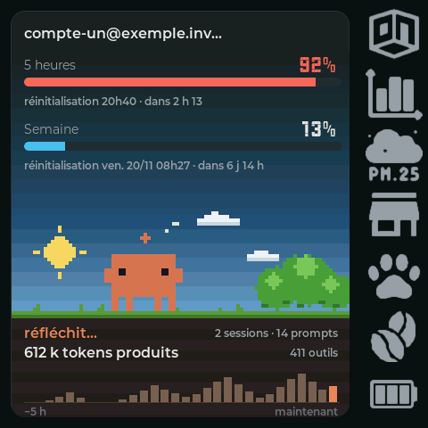<br><b>IA</b> — l'activité de l'agent Claude du PC, sous un ciel qui suit la météo</td>
  </tr>
</table>

<details>
<summary>Les autres pages (cliquer pour déplier)</summary>
<table>
  <tr>
    <td width="25%" valign="top">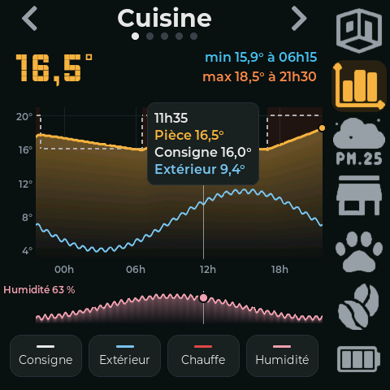<br><b>Graphes</b> — 24 h glissantes, lecture au doigt, valeur du jour en ambre</td>
    <td width="25%" valign="top">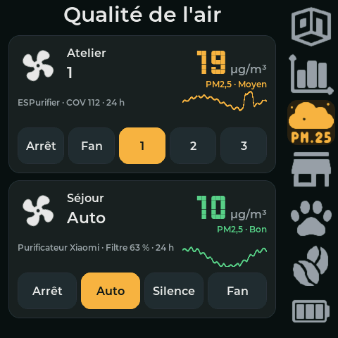<br><b>Qualité de l'air</b> — deux purificateurs, PM1/PM2,5/PM10 colorés selon le niveau</td>
    <td width="25%" valign="top">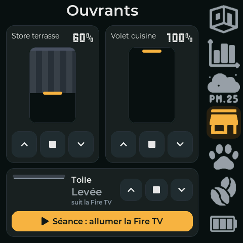<br><b>Ouvrants</b> — store, volet, toile de projection, réglage au doigt</td>
    <td width="25%" valign="top">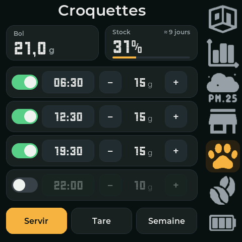<br><b>Croquettes</b> — distributeur : bol, stock, 4 repas, semaine</td>
  </tr>
  <tr>
    <td width="25%" valign="top">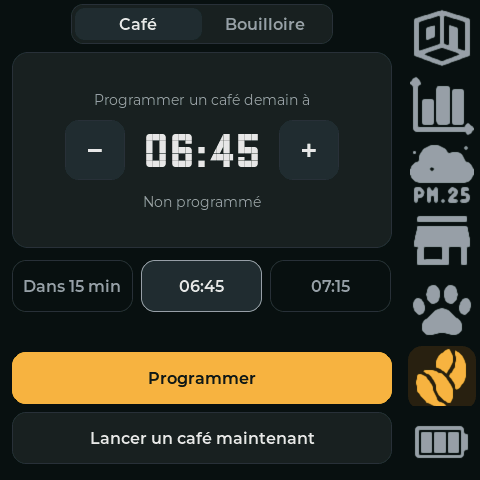<br><b>Café</b> — machine et bouilloire : programmation, températures</td>
    <td width="25%" valign="top">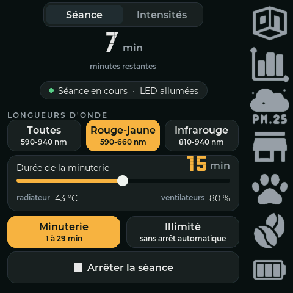<br><b>Panneau LED</b> — séances lumineuses : intensités, longueurs d'onde, minuterie</td>
    <td width="25%" valign="top">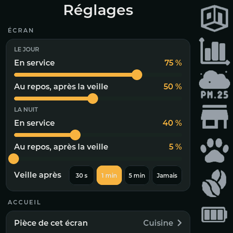<br><b>Réglages</b> — luminosité jour/nuit, veille, pièce de l'écran, Wi-Fi</td>
    <td width="25%" valign="top">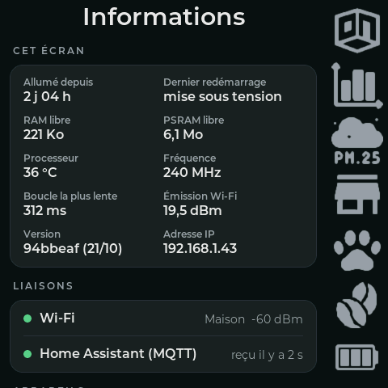<br><b>Informations</b> — santé de l'écran, liaisons au vert ou au rouge, journal</td>
  </tr>
</table>

</details>

## Page « IA »

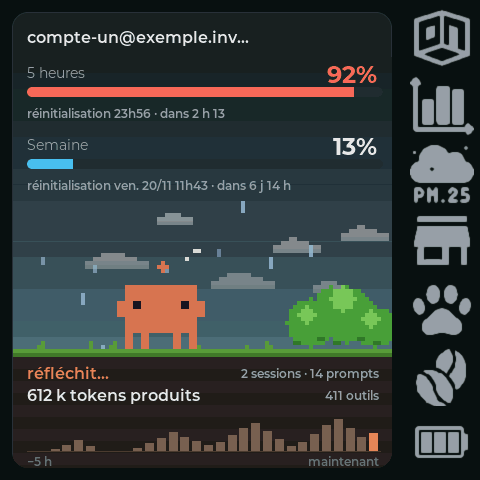

Juste après PC dans le rail, une page montre l'agent Claude qui tourne sur le PC : état (réfléchit,
en attente, au repos), jetons produits, outils, prompts, sessions, et un histogramme 5 h par
tranches de 10 min. Les données arrivent par deux sujets MQTT retenus (`pc/ia`, `pc/ia_activite` —
[détail du contrat](CONTRAT_MQTT.md)). Pour les publier depuis votre PC : [tools/claude_ia/](tools/claude_ia/)
(hook Claude Code et petit agent Python, installation pas à pas dans son README).

La scène a un **ciel animé** : soleil et lune suivent leur arc d'après les heures réelles publiées
par Home Assistant (`maison/ciel`, automatisation fournie dans [ha_propositions/](ha_propositions/)),
la lune a sa vraie phase, l'aube et le crépuscule teintent le ciel, les nuages dérivent, la pluie
tombe, l'orage éclaire le ciel (ci-dessus, animation du simulateur), la neige blanchit le sol et le
brouillard voile la scène. Tous les dessins pixel sont régénérés par [tools/gen_scene_ia.py](tools/gen_scene_ia.py).

> Cette page est un **projet de fan non officiel, non affilié à Anthropic**. « Claude » et « Clawd »
> sont des marques d'Anthropic. Les dessins de Clawd sont des dessins originaux, **exclus de la
> licence MIT** ([lib/icones/NOTICE_CLAWD.md](lib/icones/NOTICE_CLAWD.md)). La page est inspirée de
> [Clawdmeter](https://github.com/HermannBjorgvin/Clawdmeter) — rien de ce projet n'y est copié.

## Écran sur batterie

Une variante **sans fil** du même écran, dans un boîtier imprimé en 3D (photo en haut de page) : quatre
cellules 18650, un radar de présence qui le réveille quand quelqu'un approche, et la veille profonde le
reste du temps. C'est le même firmware que les écrans muraux : l'écran se reconnaît à son adresse MAC.

- **2 mA en veille profonde**, réveillé par le radar HLK-LD2410S, sans avoir à le toucher.
- **Réveil mesuré** (un réveil, 13/11/2026) : écran éclairé **1,8 s** après le réveil de la puce, données de
  Home Assistant à jour à **2,7 s**. La borne Wi-Fi est gardée en mémoire (pas de balayage). Le délai propre
  du radar, entre le passage et le réveil de la puce, n'est pas compté.
- **Autonomie estimée** sur 16 000 mAh : environ 200 jours pour 20 passages par jour, un mois environ si
  quelqu'un reste 3 h par jour dans le champ du radar.
- **Carte modifiée** pour libérer des broches et ne rien laisser consommer en veille ; **boîtier dessiné
  de A à Z**, fichiers STL fournis.

Il a deux pages à lui :

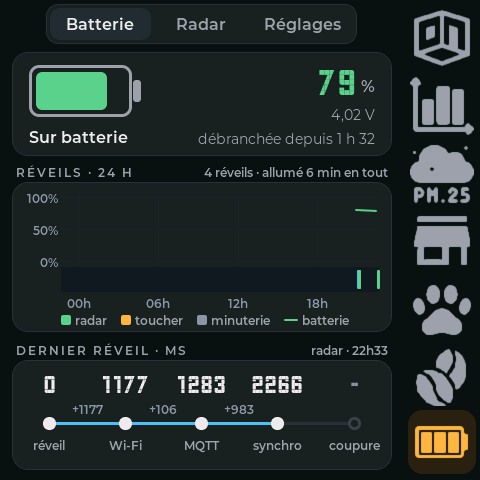 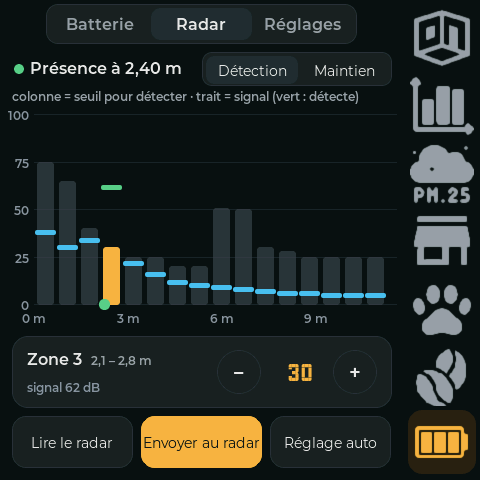

*À gauche, **Batterie** : charge, réveils sur 24 h, détail du dernier réveil en millisecondes, comptées
depuis le lancement du programme, environ 0,5 s après le réveil de la puce (capture de l'écran réel du séjour,
réveil par le radar à 22h33). À droite, **Radar** : zones, sensibilité, réglage automatique, test sur place.*

Câblage, modifications de la carte, mesures et boîtier : [materiel/ecran-batterie/](materiel/ecran-batterie/).

## Matériel

- Écran **Guition ESP32-S3-4848S040** (4", 480 × 480) : module **ESP32-S3 N16R8V** (16 Mo flash, 8 Mo PSRAM),
  dalle **ST7701S** pilotée en RGB, tactile capacitif **GT911**.
- Le pilote d'affichage est fourni par [LovyanGFX](https://github.com/lovyan03/LovyanGFX)
  (classe `Panel_ST7701_guition_esp32_4848S040`, voir [include/LGFX_ESP32S3_RGB_TFT_SPI_ST7701_GT911.h](include/LGFX_ESP32S3_RGB_TFT_SPI_ST7701_GT911.h)).
- Carte PlatformIO : [board/esp32-s3-devkitc-1-n16r8v.json](board/esp32-s3-devkitc-1-n16r8v.json)
  (devkitc-1, 16 Mo / 8 Mo). Partitions : `large_spiffs_16MB.csv`, ~10 Mo de LittleFS.
- Alimentation : 5 V. Les écrans sur batterie ajoutent 4 cellules 18650 (chargées par le circuit d'origine de la carte)
  et un radar HLK-LD2410S.
- Sur ces puces, les eFuses verrouillent la flash en **DIO** (2 fils) : les tentatives QIO/QOUT retombent
  en DIO au démarrage — documenté dans les commentaires de [platformio.ini](platformio.ini).

Mesuré sur cette branche (8/11/2026) : **Flash 56,0 %** (2 641 031 o / 4 718 592 o), **RAM interne 25,1 %**
(82 160 o / 327 680 o), image finale 2 677 199 o.

## Architecture

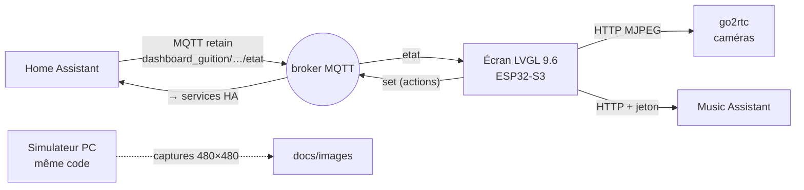

- **L'écran ne parle qu'à HA, par MQTT** (une seule forme pour toutes les pages : `etat` retenu
  HA → écran, `set` écran → HA). Le détail topic par topic est dans [CONTRAT_MQTT.md](CONTRAT_MQTT.md).
  Seules exceptions : les images lourdes (flux caméra, miniatures, pochettes), chargées en HTTP.
- **Un seul environnement de compilation pour toute la production** (`ecran`) : chaque écran se
  reconnaît à son **adresse Wi-Fi MAC**, table `ECRANS[]` de [src/ecran/ecran.cpp](src/ecran/ecran.cpp)
  (nom de la pièce, IP statique, rotation, batterie). Les écrans prennent une IP statique
  (`RESEAU_OCTET_*` + dernier octet) pour qu'OTA et banc fonctionnent toujours.
- **LVGL 9.6.0 est vendorisée** dans [lib/lvgl-9.6.0](lib/lvgl-9.6.0), allégée (sans docs ni exemples)
  et **patchée à la main** : trois correctifs sont appliqués — défilement `scroll_bande_9.6.patch`
  (marqueur `.bande-applique`), tuiles limitées à la zone utile `lvgl_9.6.0_tuiles_zone_utile.patch`
  et élagage du parcours `lvgl_9.6.0_elagage_parcours.patch` ; les deux autres patchs LVGL de
  `docs/patches/` sont protégés par des drapeaux de compilation et non appliqués.
- **Build hybride pioarduino** : plateforme figée `55.03.312-1` (Arduino 3.3.12 / ESP-IDF 5.5.5).
- **Wi-Fi recompilé pour la caméra** (`custom_sdkconfig`) : la version précompilée bridait le flux vidéo.
  Une fenêtre TCP plus grande et quelques réglages du flux donnent les cadences de
  [Caméra en direct](#caméra-en-direct) ; en échange, le Wi-Fi occupe plus de RAM interne.
- **Programme en PSRAM (XIP)** : sans lui, l'écran à 17 MHz saute dès que la flash travaille (Wi-Fi,
  réglages). Il coûte 2,55 Mo de PSRAM ([détails](docs/SOUS_LE_CAPOT.md)).
- **`upload_port` obligatoire** dans `platformio.ini`, même pour compiler : sans adresse, la
  recompilation des bibliothèques s'arrête en silence à mi-chemin. Indiquez l'IP de votre écran.
- Le fichier `include/version_git.h` (commit affiché page Infos) est écrit par `version_git.py` avant
  chaque compilation.
- Codage en **C++ avec identifiants français** : c'est le choix du projet, assumé et homogène.

## Sous le capot

Les points résumés ici ont tous été mesurés sur l'écran ou au simulateur. La LVGL patchée ne repeint que deux
bandes pendant le défilement : **61 → 9 ms** par pas de geste. L'anneau du thermostat n'invalide
que sa zone changeante : **75 → 24 ms** par pas de consigne. À la fermeture, la caméra rend
**1,67 Mo** de tampons. Le simulateur PC compile le vrai code des pages et le chien de garde
relance un écran figé en disant où il était.

→ [Lire la suite dans docs/SOUS_LE_CAPOT.md](docs/SOUS_LE_CAPOT.md)

## Démarrage rapide

```bash
git clone https://github.com/grizli21/guition-ha-dashboard.git && cd guition-ha-dashboard
cp src/secrets_mqtt.h.exemple src/secrets_mqtt.h            # puis remplir : broker MQTT
cp src/secrets_ma.h.exemple src/secrets_ma.h                # Music Assistant
cp src/ecran/secrets_wifi.h.exemple src/ecran/secrets_wifi.h  # Wi-Fi et plan d'IP
pio run -e ecran-usb -t upload --upload-port /dev/ttyACM0   # premier flash par câble, ensuite en OTA
make -C simu                                                # simulateur PC : captures dans simu/captures/
```

Il faut ensuite déclarer ses écrans par leur adresse MAC (table `ECRANS[]`) et brancher Home Assistant
(24 automatisations prêtes dans [ha_propositions/](ha_propositions/)). L'interface existe aussi en
**anglais** (`-D UI_LANG_EN`). Pas à pas complet : **[docs/INSTALLATION.md](docs/INSTALLATION.md)**.

**Juste pour voir ?** Le **mode démo** (`-D MODE_DEMO`) remplit toutes les pages sans Home Assistant, sans
broker MQTT et sans Wi-Fi, et les boutons principaux répondent ([voir comment](docs/INSTALLATION.md#mode-démo--essayer-sans-home-assistant)).

**Sous Windows 10/11 ?** Outillage, pièges (chemins longs, ports COM, pilote, WSL pour le simulateur) :
**[mode d'emploi dédié](docs/INSTALLATION.md#sous-windows-1011)**.

## Aller plus loin

- [docs/INSTALLATION.md](docs/INSTALLATION.md) — installation pas à pas : secrets, écrans par MAC, flash USB puis OTA, Home Assistant, langue, simulateur, **mode d'emploi Windows**.
- [docs/SOUS_LE_CAPOT.md](docs/SOUS_LE_CAPOT.md) — tous les points techniques, avec leurs mesures.
- [docs/DEVELOPPEMENT.md](docs/DEVELOPPEMENT.md) — outillage, ajouter une page, diagnostics, simulateur en détail, arborescence.
- [docs/IMPRIMANTE.md](docs/IMPRIMANTE.md) — page Imprimante 3D : ce qu'il faut (Klipper + Moonraker, miniatures du slicer, caméra), quoi activer, ce qui est propre à votre machine.
- [docs/CREDITS.md](docs/CREDITS.md) — licence, bibliothèques, polices et icônes, avec leurs licences.
- [materiel/ecran-batterie/](materiel/ecran-batterie/) — l'écran sur batterie : radar, consommation mesurée, économies du firmware, boîtier 3D (licence CC BY-NC 4.0).
- [materiel/support-bureau/](materiel/support-bureau/) — support de bureau imprimable en 3D, adapté à la rotation 0 (licence CC BY-NC-SA 4.0).

## Limites connues

- **Pensé pour un réseau local de confiance** : MQTT en 1883 sans TLS, OTA sans mot de passe,
  caméra en MJPEG HTTP. À ne pas exposer sur Internet.
- LVGL 9.6 vendorisée et patchée : ne pas la remplacer par la version du registre sans rejouer les
  trois patchs appliqués de `docs/patches/` (défilement par bande — ce qui fait la fluidité —,
  tuiles limitées à la zone utile, élagage du parcours).
- Flash verrouillée en DIO par eFuse sur ces modules N16R8V (voir platformio.ini).
- Les captures du simulateur utilisent des images de démonstration : mires synthétiques (caméras,
  pochettes de test, logos), une pochette libre de droit sous licence CC0 (« CommoNasm ») et de vraies
  images des caméras de l'imprimante de l'auteur, publiées avec son accord
  (détails dans [docs/CREDITS.md](docs/CREDITS.md)) : remplacez
  `simu/donnees/cameras|pochettes|logos` par vos propres images pour vos essais.
- L'automatisation « PC » suppose un petit agent publiant `dashboard_guition/pc/*` (contrat
  documenté, agent non fourni).

## Licence et crédits

Code de ce dépôt : **MIT** ([LICENSE](LICENSE)). Exceptions : les fichiers 3D de `materiel/` ont leur
propre licence, indiquée dans leur dossier ; les **dessins de Clawd** (`lib/icones/*_ia*`, mascotte de
Claude Code) sont des dessins originaux exclus de la licence MIT
([lib/icones/NOTICE_CLAWD.md](lib/icones/NOTICE_CLAWD.md)). Bibliothèques, polices et icônes utilisées,
avec leurs licences : **[docs/CREDITS.md](docs/CREDITS.md)**.

Développé avec l'aide d'assistants IA : Claude (Anthropic) et Qwen (exécuté en local).
