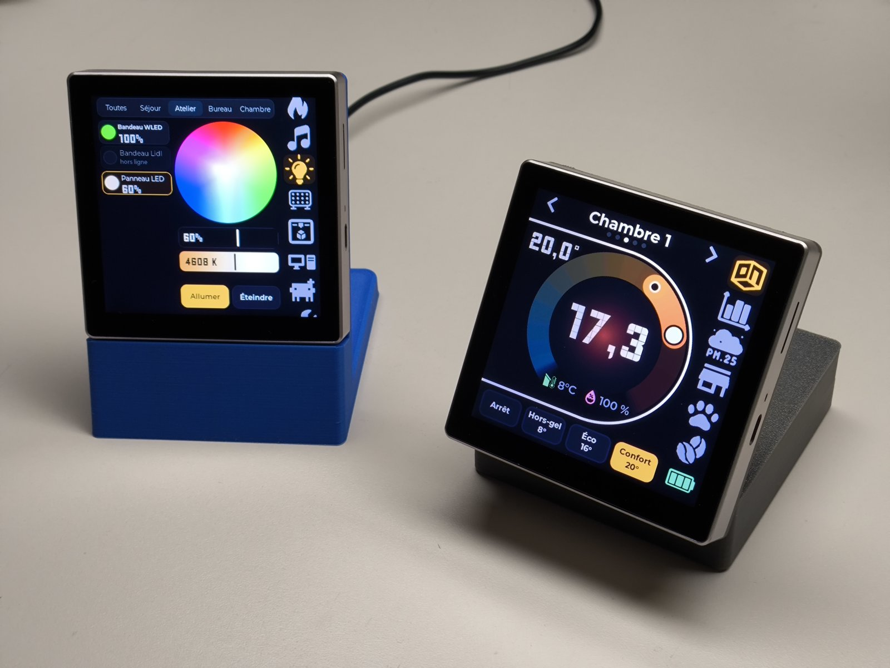
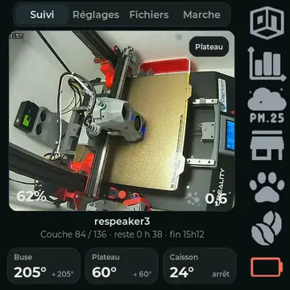
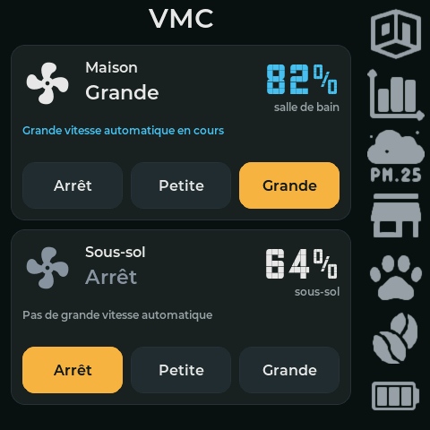
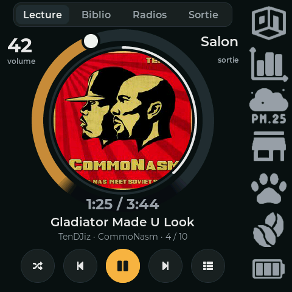
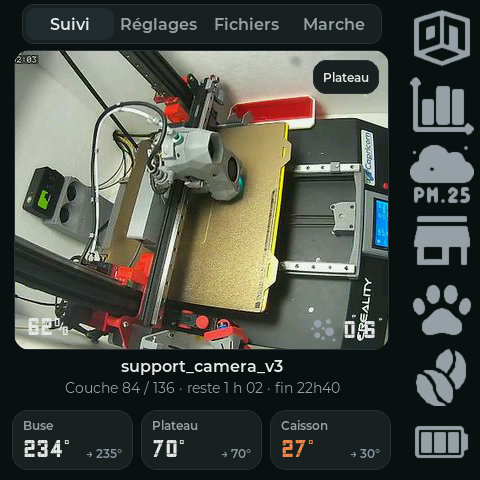
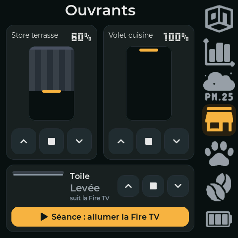
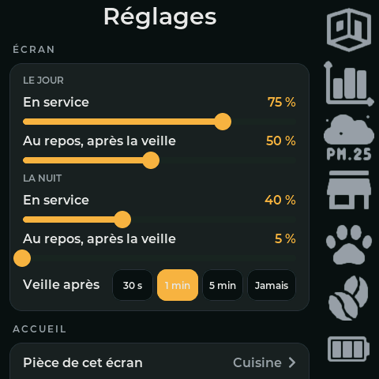
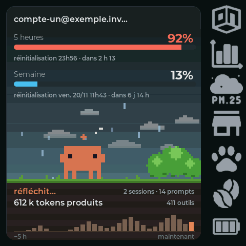
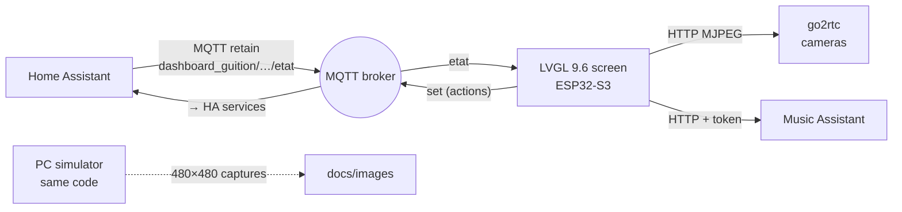

# Dashboard Guition — an LVGL wall display for Home Assistant

**English** | [Français](README.fr.md)



Wall-mounted dashboard for **Guition ESP32-S3-4848S040** screens: LVGL 9.6 firmware, driven by
**Home Assistant over MQTT**, with a **PC simulator** that compiles the actual page code and outputs
480 × 480 captures. Nineteen touch pages for the home: heating, 24 h charts, air quality, covers,
feeder, coffee, hot water, ventilation, wood stove, music, lights, LED panel, 3D printer, PC, AI,
settings, info, battery and radar.

It also comes in a **wireless version** (on the right in the photo, on its pivot): battery, presence
radar, 2 mA deep sleep — see [Battery-powered display](#battery-powered-display).

[](LICENSE)
[](lib/lvgl-9.6.0)
[](board/esp32-s3-devkitc-1-n16r8v.json)
[](platformio.ini)
[](CONTRAT_MQTT.en.md)

---

## Contents

- [Navigation](#navigation) · [Live camera](#live-camera) · [Gallery](#gallery) · [The "AI" page](#the-ai-page) · [Battery-powered display](#battery-powered-display)
- [Hardware](#hardware) · [Architecture](#architecture) · [Under the hood](#under-the-hood) · [Quick start](#quick-start) · [Going further](#going-further) · [Known limitations](#known-limitations) · [License and credits](#license-and-credits)
- Detailed pages: [Installation](docs/en/INSTALLATION.md) · [Under the hood](docs/en/SOUS_LE_CAPOT.md) · [3D Printer](docs/en/IMPRIMANTE.md) · [Development](docs/en/DEVELOPPEMENT.md) · [Credits](docs/en/CREDITS.md) · [Battery-powered display](materiel/ecran-batterie/README.en.md) · [3D stand](materiel/support-bureau/README.en.md)

## Navigation


The right-hand rail is a swipeable **carousel of icons**: 17 icons of 64 px, with no snapping and no
rubber-banding — it stops exactly on the first and the last icon. Tapping an icon switches the page
instantly; the pinned page (here the battery) stays fixed at the bottom.

The animation comes from the simulator, at the real timings of the gesture: from the Info page, the
rail slides and stops at the top, a tap opens the heating page, then a tap on Comfort sweeps the ring up
to the 20° setpoint.

## Live camera



The 3D Printer page shows the printer cameras **live, frame after frame** (MJPEG via go2rtc). Here, a
complete park of the print head, seen by the enclosure camera and then by the bed camera; the frames are
the real ones, recorded during the park, replayed in the simulator at the rate **measured on the
screen**:

| Camera | Measured on the screen | Source setting |
|---|---|---|
| Enclosure (thingino, 640 × 360 sub-stream) | ≈ 18.7 frames/s | 20 frames/s |
| Bed (crowsnest) | ≈ 14.4 frames/s | 15 frames/s |

The screen follows what the source sends: the camera setting sets the rate. While the rail moves, the
stream pauses and resumes 300 ms after it stops (otherwise the camera would chop up the gesture).
Setting up a Klipper/Moonraker printer: [docs/en/IMPRIMANTE.md](docs/en/IMPRIMANTE.md).

## Gallery

Real rendering of the code, captured by the simulator (`make -C simu`). The numeric values use the K-Type
“3x5” pixel font, an **option** you download yourself (personal use); by default, the firmware shows them in
Montserrat Bold — see [tools/fonts/README.en.md](tools/fonts/README.en.md#option-the-3x5-pixel-font-in-the-captures).

<table>
  <tr>
    <td width="33%" valign="top"><br><b>Heating</b> — measured temperature, setpoint on the ring, heating glow, modes</td>
    <td width="33%" valign="top"><br><b>Hot water</b> — tank, setpoint on the ring, forced heating, 24 h curve</td>
    <td width="33%" valign="top"><br><b>Ventilation</b> — speed per zone, live humidity, animated fans</td>
  </tr>
  <tr>
    <td width="33%" valign="top"><br><b>Wood stove</b> — draft regulated on the flue gas temperature, reload alert, curves</td>
    <td width="33%" valign="top"><br><b>Music</b> — Music Assistant: playback, library, albums, radios, output</td>
    <td width="33%" valign="top"><br><b>Lights</b> — one lamp selected, color picked on the wheel, brightness by finger</td>
  </tr>
  <tr>
    <td width="33%" valign="top"><br><b>3D Printer</b> — files and thumbnails, current layer tracking, live cameras</td>
    <td width="33%" valign="top"><br><b>PC</b> — system, GPU, processes, local AI, sleep</td>
    <td width="33%" valign="top"><br><b>AI</b> — activity of the Claude agent on your PC, under a sky that follows the weather</td>
  </tr>
</table>

<details>
<summary>The other pages (click to expand)</summary>
<table>
  <tr>
    <td width="25%" valign="top"><br><b>Charts</b> — scrolling 24 h, finger reading, today's value in amber</td>
    <td width="25%" valign="top"><br><b>Air Quality</b> — two air purifiers, PM1/PM2.5/PM10 color-coded by level</td>
    <td width="25%" valign="top"><br><b>Covers</b> — blind, shutter, projection screen, finger adjustment</td>
    <td width="25%" valign="top"><br><b>Feeder</b> — dispenser: bowl, stock, 4 meals, week</td>
  </tr>
  <tr>
    <td width="25%" valign="top"><br><b>Coffee</b> — machine and kettle: scheduling, temperatures</td>
    <td width="25%" valign="top"><br><b>LED Panel</b> — light sessions: intensity levels, wavelengths, timer</td>
    <td width="25%" valign="top"><br><b>Settings</b> — day/night brightness, sleep, room of the display, Wi-Fi</td>
    <td width="25%" valign="top"><br><b>Info</b> — screen health, links green or red, log</td>
  </tr>
</table>

</details>

## The "AI" page



Right after PC in the rail, a page shows the Claude agent running on your PC: state (thinking,
waiting, idle), tokens produced, tool calls, prompts, sessions, and a 5 h histogram in 10-min
slices. The data arrives over two retained MQTT topics (`pc/ia`, `pc/ia_activite` —
[contract details](CONTRAT_MQTT.en.md)). To publish them from your own PC: [tools/claude_ia/](tools/claude_ia/)
(Claude Code hook and small Python agent, step-by-step install in its README).

The scene has an **animated sky**: sun and moon travel along their arcs, driven by the real times
published by Home Assistant (`maison/ciel`, a ready-made automation in
[ha_propositions/](ha_propositions/)); the moon carries its true phase; dawn and dusk tint the sky;
clouds drift, rain falls, storms light up the sky (above, simulator animation), snow whitens the
ground and fog veils the scene. Every pixel drawing is regenerated by [tools/gen_scene_ia.py](tools/gen_scene_ia.py).

> This page is an **unofficial fan project, not affiliated with Anthropic**. "Claude" and "Clawd" are
> trademarks of Anthropic. The Clawd drawings are original artwork, **excluded from the MIT license**
> ([lib/icones/NOTICE_CLAWD.md](lib/icones/NOTICE_CLAWD.md)). The page was inspired by
> [Clawdmeter](https://github.com/HermannBjorgvin/Clawdmeter) — nothing from that project is copied here.

## Battery-powered display

A **wireless** version of the same display, in a 3D-printed case (photo at the top of the page): four
18650 cells, a presence radar that wakes it when someone comes near, and deep sleep the rest of the time.
It runs the same firmware as the wall displays: the display recognizes itself by its MAC address.

- **2 mA in deep sleep**, woken by the HLK-LD2410S radar, no touch needed.
- **Measured wake-up** (one wake-up, 13 Nov 2026): screen lit **1.8 s** after the chip wakes up, Home
  Assistant data up to date at **2.7 s**. The Wi-Fi access point is kept in memory (no scan). The radar's own
  delay, between someone walking by and the chip waking up, is not counted.
- **Estimated battery life** on 16,000 mAh: about 200 days for 20 walk-bys a day, about a month if someone
  stays in the radar's field 3 h a day.
- **Modified board** to free pins and leave nothing drawing current in sleep; **case designed from
  scratch**, STL files included.

It has two pages of its own:

 

*Left, **Battery**: charge, wake-ups over 24 h, breakdown of the last wake-up in milliseconds, counted
from the program start, about 0.5 s after the chip wakes up (capture from the real living-room display, radar
wake-up at 22:33). Right, **Radar**: zones, sensitivity, automatic tuning, on-the-spot test.*

Wiring, board modifications, measurements and case: [materiel/ecran-batterie/README.en.md](materiel/ecran-batterie/README.en.md).

## Hardware

- **Guition ESP32-S3-4848S040** display (4", 480 × 480): **ESP32-S3 N16R8V** module (16 MB flash,
  8 MB PSRAM), **ST7701S** panel driven in RGB, **GT911** capacitive touch.
- The display driver comes from [LovyanGFX](https://github.com/lovyan03/LovyanGFX)
  (class `Panel_ST7701_guition_esp32_4848S040`, see [include/LGFX_ESP32S3_RGB_TFT_SPI_ST7701_GT911.h](include/LGFX_ESP32S3_RGB_TFT_SPI_ST7701_GT911.h)).
- PlatformIO board: [board/esp32-s3-devkitc-1-n16r8v.json](board/esp32-s3-devkitc-1-n16r8v.json)
  (devkitc-1, 16 MB / 8 MB). Partitions: `large_spiffs_16MB.csv`, ~10 MB of LittleFS.
- Power supply: 5 V. Battery-powered displays add four 18650 cells (charged by the board's own circuit)
  and an HLK-LD2410S radar.
- On these chips, the eFuses lock the flash to **DIO** (2 wires): QIO/QOUT attempts fall back
  to DIO at boot — documented in the comments of [platformio.ini](platformio.ini).

Measured on this branch (8 Nov 2026): **Flash 56.0 %** (2,641,031 B / 4,718,592 B), **internal RAM 25.1 %**
(82,160 B / 327,680 B), final image 2,677,199 B.

## Architecture



- **The screen only talks to HA, over MQTT** (one single pattern for all the pages: retained
  `etat` HA → screen, `set` screen → HA). The topic-by-topic detail is in [CONTRAT_MQTT.en.md](CONTRAT_MQTT.en.md).
  The only exceptions: heavy images (camera streams, thumbnails, album art), loaded over HTTP.
- **A single build environment for the whole production** (`ecran`): each screen recognizes
  itself by its **Wi-Fi MAC address**, the `ECRANS[]` table in [src/ecran/ecran.cpp](src/ecran/ecran.cpp)
  (room name, static IP, rotation, battery). The screens take a static IP
  (`RESEAU_OCTET_*` + last octet) so OTA and the test bench always work.
- **LVGL 9.6.0 is vendored** in [lib/lvgl-9.6.0](lib/lvgl-9.6.0), trimmed down (no docs or examples)
  and **patched by hand**: three fixes are applied — scrolling `scroll_bande_9.6.patch`
  (marker `.bande-applique`), tiles limited to the useful area `lvgl_9.6.0_tuiles_zone_utile.patch`
  and traversal pruning `lvgl_9.6.0_elagage_parcours.patch`; the two other LVGL patches in
  `docs/patches/` are guarded by compile flags and not applied.
- **Hybrid pioarduino build**: pinned platform `55.03.312-1` (Arduino 3.3.12 / ESP-IDF 5.5.5).
- **Recompiled Wi-Fi for the camera** (`custom_sdkconfig`): the precompiled version throttled the video
  stream. A larger TCP window and a few stream tweaks give the rates shown in [Live camera](#live-camera);
  in exchange, Wi-Fi takes up more internal RAM.
- **Program in PSRAM (XIP)**: without it, the 17 MHz screen jumps as soon as the flash is busy (Wi-Fi,
  settings). It costs 2.55 MB of PSRAM ([details](docs/en/SOUS_LE_CAPOT.md)).
- **`upload_port` is required** in `platformio.ini`, even just to build: without an address, the
  library rebuild silently stops halfway. Put your screen's IP there.
- The `include/version_git.h` file (commit shown on the Info page) is written by `version_git.py` before
  each build.
- The code is written in **C++ with French identifiers**: the project's choice, deliberate and consistent.

## Under the hood

The points summarized here were all measured on the screen or in the simulator. The patched LVGL repaints
only two strips during scrolling: **61 → 9 ms** per gesture step. The thermostat ring only invalidates
its changing area: **75 → 24 ms** per setpoint step. On closing, the camera gives back
**1.67 MB** of buffers. The PC simulator compiles the actual page code, and the watchdog restarts
a frozen screen while saying where it was.

→ [Read more in docs/en/SOUS_LE_CAPOT.md](docs/en/SOUS_LE_CAPOT.md)

## Quick start

```bash
git clone https://github.com/grizli21/guition-ha-dashboard.git && cd guition-ha-dashboard
cp src/secrets_mqtt.h.exemple src/secrets_mqtt.h            # then fill in: MQTT broker
cp src/secrets_ma.h.exemple src/secrets_ma.h                # Music Assistant
cp src/ecran/secrets_wifi.h.exemple src/ecran/secrets_wifi.h  # Wi-Fi and IP plan
pio run -e ecran-usb -t upload --upload-port /dev/ttyACM0   # first flash over cable, then OTA
make -C simu                                                # PC simulator: captures in simu/captures/
```

You then declare your screens by MAC address (`ECRANS[]` table) and connect Home Assistant
(24 ready-made automations in [ha_propositions/](ha_propositions/)). The interface is also available in
**English** (`-D UI_LANG_EN`). The full step-by-step guide: **[docs/en/INSTALLATION.md](docs/en/INSTALLATION.md)**.

**Just want to see?** **Demo mode** (`-D MODE_DEMO`) fills every page without Home Assistant, without an
MQTT broker and without Wi-Fi, and the main buttons respond ([see how](docs/en/INSTALLATION.md#demo-mode-try-it-without-home-assistant)).

**On Windows 10/11?** Tooling and pitfalls (long paths, COM ports, driver, WSL for the simulator):
**[dedicated guide](docs/en/INSTALLATION.md#on-windows-1011)**.

## Going further

- [docs/en/INSTALLATION.md](docs/en/INSTALLATION.md) — step-by-step installation: secrets, screens by MAC, USB then OTA flashing, Home Assistant, language, simulator, **Windows guide**.
- [docs/en/SOUS_LE_CAPOT.md](docs/en/SOUS_LE_CAPOT.md) — all the technical points in full, with their measurements.
- [docs/en/DEVELOPPEMENT.md](docs/en/DEVELOPPEMENT.md) — tooling, adding a page, diagnostics, the simulator in detail, file tree.
- [docs/en/IMPRIMANTE.md](docs/en/IMPRIMANTE.md) — the 3D Printer page: what you need (Klipper + Moonraker, slicer thumbnails, camera), what to enable, what is specific to your machine.
- [docs/en/CREDITS.md](docs/en/CREDITS.md) — license, libraries, fonts and icons, with their licenses.
- [materiel/ecran-batterie/README.en.md](materiel/ecran-batterie/README.en.md) — the battery-powered display: radar, measured consumption, firmware savings, 3D case (CC BY-NC 4.0 license).
- [materiel/support-bureau/README.en.md](materiel/support-bureau/README.en.md) — printable 3D desk stand, adapted to rotation 0 (CC BY-NC-SA 4.0 license).

## Known limitations

- **Designed for a trusted local network**: MQTT on 1883 without TLS, OTA without a password,
  camera over MJPEG HTTP. Do not expose it to the Internet.
- Vendored, patched LVGL 9.6: do not replace it with the registry version without replaying the
  three applied patches in `docs/patches/` (banded scrolling — what makes scrolling smooth —,
  tiles limited to the useful area, traversal pruning).
- Flash locked to DIO by eFuse on these N16R8V modules (see platformio.ini).
- The simulator captures use demo images: synthetic test patterns (cameras, test album art, logos),
  one free-license CC0 album cover (“CommoNasm”) and real images from the author's own printer
  cameras, published with his consent
  (details in [docs/en/CREDITS.md](docs/en/CREDITS.md)): replace
  `simu/donnees/cameras|pochettes|logos` with your own images for your own tests.
- The “PC” automation assumes a small agent publishing `dashboard_guition/pc/*` (documented
  contract, agent not provided).

## License and credits

Code in this repository: **MIT** ([LICENSE](LICENSE)). Exceptions: the 3D files in `materiel/` have their
own license, stated in their folder; the **Clawd drawings** (`lib/icones/*_ia*`, the Claude Code mascot)
are original artwork **excluded from the MIT license** ([lib/icones/NOTICE_CLAWD.md](lib/icones/NOTICE_CLAWD.md)).
Libraries, fonts and icons used, with their licenses: **[docs/en/CREDITS.md](docs/en/CREDITS.md)**.

Developed with the help of AI assistants: Claude (Anthropic) and Qwen (run locally).
