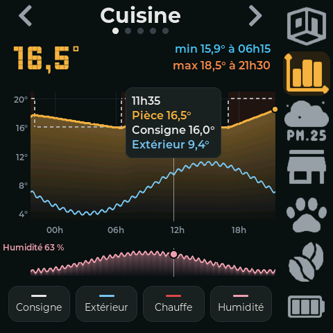
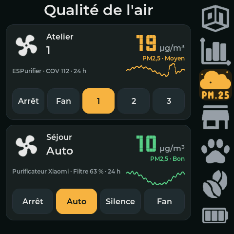
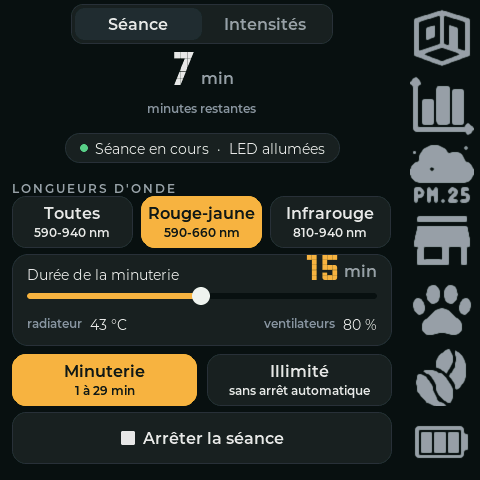
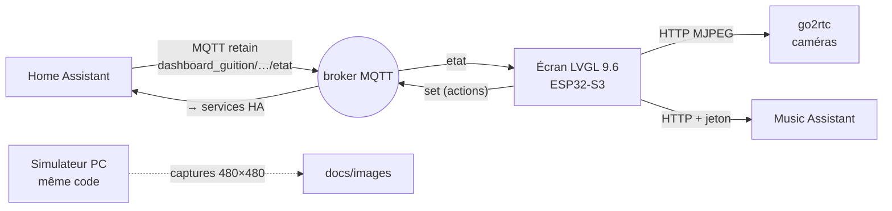

# Dashboard Guition — écran mural LVGL pour Home Assistant

Tableau de bord mural pour écrans **Guition ESP32-S3-4848S040** : firmware LVGL 9.6, piloté par
**Home Assistant via MQTT**, avec un **simulateur PC** qui compile le vrai code des pages et sort des
captures 480 × 480. Dix-huit pages tactiles pensées pour la maison : chauffage, graphes 24 h,
qualité de l'air, ouvrants, croquettes, café, eau chaude, VMC, poêle à bois, musique, lumières,
panneau LED, imprimante 3D, PC, réglages, informations, batterie — plus la page radar des écrans
sur batterie.

**EN.** Wall-mounted dashboard for Guition ESP32-S3-4848S040 screens: an LVGL 9.6 firmware driven by
Home Assistant over MQTT, plus a PC simulator that compiles the very same page code and renders
480×480 captures. 18 touchscreen pages — heating, hot water, VMC, wood stove, music, lights,
3D printer, PC, air quality, and more. **The interface is available in English**: add `-D UI_LANG_EN`
to `build_flags` in `platformio.ini` (French by default; vocabulary in [docs/GLOSSAIRE_EN.md](docs/GLOSSAIRE_EN.md)).

[](LICENSE)
[](lib/lvgl-9.6.0)
[](board/esp32-s3-devkitc-1-n16r8v.json)
[](platformio.ini)
[](CONTRAT_MQTT.md)

---

## Sommaire

- [Galerie](#galerie) · [Navigation](#navigation) · [Matériel](#matériel) · [Architecture](#architecture) · [Sous le capot](#sous-le-capot)
- [Démarrage rapide](#démarrage-rapide) · [Aller plus loin](#aller-plus-loin) · [Limites connues](#limites-connues) · [Licence et crédits](#licence-et-crédits)
- Pages détaillées : [Installation](docs/INSTALLATION.md) · [Sous le capot](docs/SOUS_LE_CAPOT.md) · [Développement](docs/DEVELOPPEMENT.md) · [Crédits](docs/CREDITS.md) · [Support 3D](materiel/support-bureau/)

L'anneau du chauffage pendant la montée en température (9 images du simulateur, animées) :


## Galerie

Rendu réel du code, capturé par le simulateur (`make -C simu`). Les valeurs chiffrées y sont dans la police pixel
« 3x5 » de K-Type, une **option** à télécharger soi-même (usage personnel) ; par défaut, le firmware les affiche en
Montserrat Bold — voir [tools/fonts/README.md](tools/fonts/README.md#option--la-police-pixel--3x5--des-captures).

<table>
  <tr>
    <td><br><b>Chauffage</b> — 16,4° mesurés, consigne 20° à l'anneau, lueur de chauffe, modes arrêt / hors-gel / éco / confort</td>
    <td><br><b>Eau chaude</b> — ballon, consigne à l'anneau, chauffe forcée, courbe 24 h</td>
    <td><br><b>VMC</b> — petite / grande vitesse par zone, hygro en direct, hélices animées (GIF : un tour complet de la grande vitesse, 900 ms)</td>
    <td><br><b>Poêle à bois</b> — régulation du tirage au PID sur la température des fumées, alerte recharge, courbes</td>
  </tr>
  <tr>
    <td><br><b>Musique</b> — Music Assistant : lecture, bibliothèque, albums, radios, sortie</td>
    <td><br><b>Lumières</b> — disque chromatique, luminance, température de couleur</td>
    <td><br><b>Imprimante 3D</b> — fichiers STL et vignettes d'impression, suivi de la couche en cours</td>
    <td><br><b>PC</b> — système, GPU, processus, IA locale, mise en veille</td>
  </tr>
</table>

<details>
<summary>Les autres pages (cliquer pour déplier)</summary>
<table>
  <tr>
    <td><br><b>Graphes</b> — 24 h glissantes, lecture au doigt, valeur du jour en ambre</td>
    <td><br><b>Qualité de l'air</b> — deux purificateurs, PM1/PM2,5/PM10 colorés selon le niveau</td>
    <td><br><b>Ouvrants</b> — store, volet, toile de projection, réglage au doigt</td>
    <td><br><b>Croquettes</b> — distributeur : bol, stock, 4 repas, semaine</td>
  </tr>
  <tr>
    <td><br><b>Café</b> — machine et bouilloire : programmation, températures</td>
    <td><br><b>Panneau LED</b> — séances lumineuses : intensités, longueurs d'onde, minuterie</td>
    <td><br><b>Réglages</b> — luminosité jour/nuit, veille, pièce de l'écran, Wi-Fi</td>
    <td><br><b>Informations</b> — santé de l'écran, liaisons au vert ou au rouge, journal</td>
  </tr>
  <tr>
    <td><br><b>Batterie</b> — écran sur batterie : charge, réveils 24 h, latences Wi-Fi/MQTT</td>
    <td><br><b>Radar</b> — capteur micro-ondes LD2410S : zones, sensibilité, test sur place</td>
  </tr>
</table>

</details>

## Navigation

Le rail de droite est un **carrousel d'icônes** défilable au doigt : 16 icônes de 64 px dans une
colonne de 76 px, sans aimantation ni élastique — il s'arrête pile sur la première et la dernière.
Ce GIF, fabriqué par le simulateur aux instants réels du geste (30 ms par pas du glissé, puis 50 ms
pendant l'élan), montre le glissé, l'élan qui s'éteint, puis l'appui sur l'icône Imprimante 3D :
la page change d'un coup, le rail ne bouge pas. La page épinglée (ici la batterie, à 12 %) reste
fixe en bas, sous le carrousel.


Pendant que le rail bouge, le **flux caméra se met en pause** et ne repart que 300 ms après l'arrêt
(`RAIL_REPRISE_MS`, [src/ui_lvgl/ui_shell.cpp](src/ui_lvgl/ui_shell.cpp)) : mesuré sur l'écran, une
relance entre deux pas de l'élan espaçait les pas (47 → 135-300 ms) et étirait l'élan de 0,4-0,8 s
à 1,4-3 s — la caméra hachait le geste.

## Matériel

- Écran **Guition ESP32-S3-4848S040** (4", 480 × 480) : module **ESP32-S3 N16R8V** (16 Mo flash, 8 Mo PSRAM),
  dalle **ST7701S** pilotée en RGB, tactile capacitif **GT911**.
- Le pilote d'affichage est fourni par [LovyanGFX](https://github.com/lovyan03/LovyanGFX)
  (classe `Panel_ST7701_guition_esp32_4848S040`, voir [include/LGFX_ESP32S3_RGB_TFT_SPI_ST7701_GT911.h](include/LGFX_ESP32S3_RGB_TFT_SPI_ST7701_GT911.h)).
- Carte PlatformIO : [board/esp32-s3-devkitc-1-n16r8v.json](board/esp32-s3-devkitc-1-n16r8v.json)
  (devkitc-1, 16 Mo / 8 Mo). Partitions : `large_spiffs_16MB.csv`, ~10 Mo de LittleFS.
- Alimentation : 5 V (les écrans sur batterie ajoutent un module batterie + radar HLK-LD2410S).
- Sur ces puces, les eFuses verrouillent la flash en **DIO** (2 fils) : les tentatives QIO/QOUT retombent
  en DIO au démarrage — documenté dans les commentaires de [platformio.ini](platformio.ini).

Mesuré sur cette branche (8/11/2026) : **Flash 56,0 %** (2 641 031 o / 4 718 592 o), **RAM interne 25,1 %**
(82 160 o / 327 680 o), image finale 2 677 199 o.

## Architecture



- **L'écran ne parle qu'à HA, par MQTT** (une seule forme pour toutes les pages : `etat` retenu
  HA → écran, `set` écran → HA). Le détail topic par topic est dans [CONTRAT_MQTT.md](CONTRAT_MQTT.md).
  Seules exceptions : les images lourdes (flux caméra, miniatures, pochettes), chargées en HTTP.
- **Un seul environnement de compilation pour toute la production** (`ecran`) : chaque écran se
  reconnaît à son **adresse Wi-Fi MAC**, table `ECRANS[]` de [src/ecran/ecran.cpp](src/ecran/ecran.cpp)
  (nom de la pièce, IP statique, rotation, batterie). Les écrans prennent une IP statique
  (`RESEAU_OCTET_*` + dernier octet) pour qu'OTA et banc fonctionnent toujours.
- **LVGL 9.6.0 est vendorisée** dans [lib/lvgl-9.6.0](lib/lvgl-9.6.0), allégée (sans docs ni exemples)
  et **patchée à la main** : le correctif de défilement `scroll_bande_9.6.patch` est appliqué
  (marqueur `.bande-applique`) ; les deux autres patchs de `docs/patches/` sont protégés par des
  drapeaux de compilation et non appliqués.
- **Build hybride pioarduino** : plateforme figée `55.03.312-1` (Arduino 3.3.12 / ESP-IDF 5.5.5).
- **Wi-Fi recompilé pour la caméra** (`custom_sdkconfig`) : la version précompilée bridait le flux vidéo.
  Avec une fenêtre TCP plus grande et quelques réglages du flux, la caméra passe de 11-12 à 15-16 images/s.
  En échange, le Wi-Fi occupe plus de RAM interne.
- Le fichier `include/version_git.h` (commit affiché page Infos) est écrit par `version_git.py` avant
  chaque compilation.
- Codage en **C++ avec identifiants français** : c'est le choix du projet, assumé et homogène.

## Sous le capot

Les points résumés ici ont tous été mesurés sur l'écran ou au simulateur. La LVGL patchée ne repeint que deux
bandes pendant le défilement : **61 → 9 ms** par pas de geste. L'anneau du thermostat n'invalide
que sa zone changeante : **75 → 24 ms** par pas de consigne. À la fermeture, la caméra rend
**1,67 Mo** de tampons. Le simulateur PC compile le vrai code des pages et le chien de garde
relance un écran figé en disant où il était.

→ [Lire la suite dans docs/SOUS_LE_CAPOT.md](docs/SOUS_LE_CAPOT.md)

## Démarrage rapide

```bash
git clone https://github.com/grizli21/guition-ha-dashboard.git && cd guition-ha-dashboard
cp src/secrets_mqtt.h.exemple src/secrets_mqtt.h            # puis remplir : broker MQTT
cp src/secrets_ma.h.exemple src/secrets_ma.h                # Music Assistant
cp src/ecran/secrets_wifi.h.exemple src/ecran/secrets_wifi.h  # Wi-Fi et plan d'IP
pio run -e ecran-usb -t upload --upload-port /dev/ttyACM0   # premier flash par câble, ensuite en OTA
make -C simu                                                # simulateur PC : captures dans simu/captures/
```

Il faut ensuite déclarer ses écrans par leur adresse MAC (table `ECRANS[]`) et brancher Home Assistant
(23 automatisations prêtes dans [ha_propositions/](ha_propositions/)). L'interface existe aussi en
**anglais** (`-D UI_LANG_EN`). Pas à pas complet : **[docs/INSTALLATION.md](docs/INSTALLATION.md)**.

## Aller plus loin

- [docs/INSTALLATION.md](docs/INSTALLATION.md) — installation pas à pas : secrets, écrans par MAC, flash USB puis OTA, Home Assistant, langue, simulateur.
- [docs/SOUS_LE_CAPOT.md](docs/SOUS_LE_CAPOT.md) — les neuf points techniques complets, avec leurs mesures.
- [docs/DEVELOPPEMENT.md](docs/DEVELOPPEMENT.md) — outillage, ajouter une page, diagnostics, simulateur en détail, arborescence.
- [docs/CREDITS.md](docs/CREDITS.md) — licence, bibliothèques, polices et icônes, avec leurs licences.
- [materiel/support-bureau/](materiel/support-bureau/) — support de bureau imprimable en 3D, adapté à la rotation 0 (licence CC BY-NC-SA 4.0).

<!-- Emplacement prévu pour la future page docs/… (batterie / matériel des écrans sur batterie) :
     ajouter ici une puce de cette liste. -->

## Limites connues

- **Pensé pour un réseau local de confiance** : MQTT en 1883 sans TLS, OTA sans mot de passe,
  caméra en MJPEG HTTP. À ne pas exposer sur Internet.
- LVGL 9.6 vendorisée et patchée : ne pas la remplacer par la version du registre sans rejouer
  `docs/patches/scroll_bande_9.6.patch` (le défilement par bande est ce qui fait la fluidité).
- Flash verrouillée en DIO par eFuse sur ces modules N16R8V (voir platformio.ini).
- Les captures du simulateur utilisent des images de démonstration synthétiques (caméras, pochettes,
  logos) : remplacez `simu/donnees/cameras|pochettes|logos` par vos propres images pour vos essais.
- L'automatisation « PC » suppose un petit agent publiant `dashboard_guition/pc/*` (contract
  documenté, agent non fourni).

## Licence et crédits

Code de ce dépôt : **MIT** ([LICENSE](LICENSE)). Les fichiers 3D de `materiel/` ont leur propre licence,
indiquée dans leur dossier. Bibliothèques, polices et icônes utilisées, avec leurs licences :
**[docs/CREDITS.md](docs/CREDITS.md)**.

Développé avec l'aide d'assistants IA : Claude (Anthropic) et Qwen (exécuté en local).
