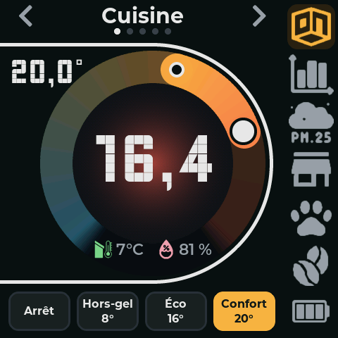
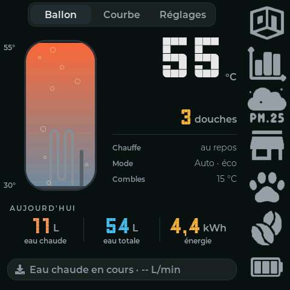
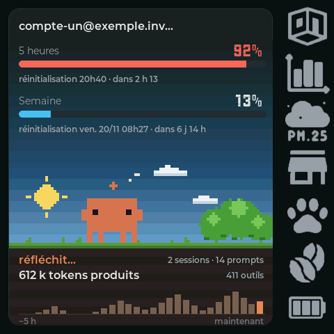
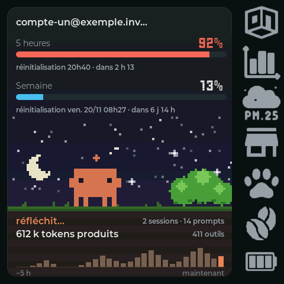
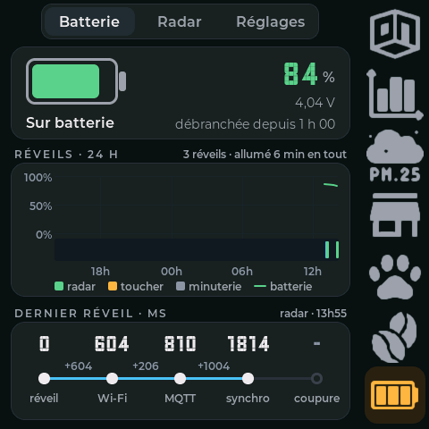
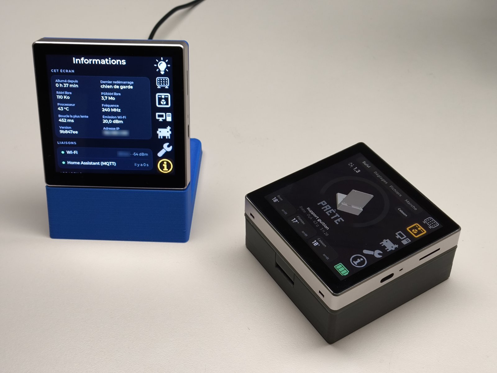
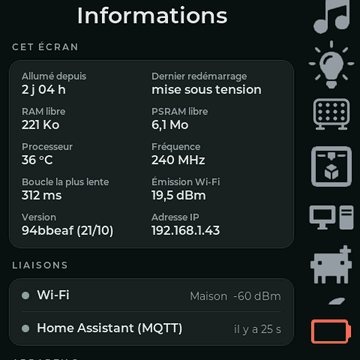
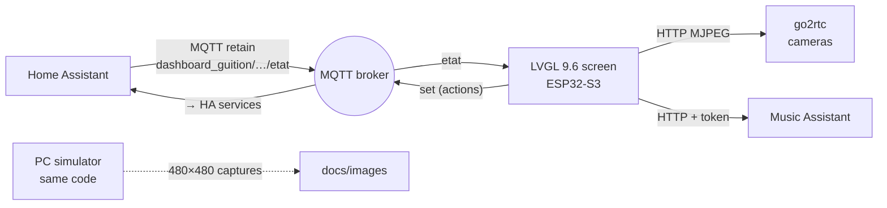

# Dashboard Guition — an LVGL wall display for Home Assistant

**English** | [Français](README.fr.md)

Wall-mounted dashboard for **Guition ESP32-S3-4848S040** screens: LVGL 9.6 firmware, driven by
**Home Assistant over MQTT**, with a **PC simulator** that compiles the actual page code and outputs
480 × 480 captures. Nineteen touch pages designed for the home: heating, 24 h charts, air quality,
covers, feeder, coffee, hot water, ventilation, wood stove, music, lights, LED panel, 3D printer,
PC, AI, settings, info, battery — plus the radar page for battery-powered screens.

It also comes in a **wireless version**: battery, presence radar, 2 mA deep sleep, 0.7 s wake-up —
see [Battery-powered display](#battery-powered-display).

[](LICENSE)
[](lib/lvgl-9.6.0)
[](board/esp32-s3-devkitc-1-n16r8v.json)
[](platformio.ini)
[](CONTRAT_MQTT.en.md)

---

## Contents

- [Gallery](#gallery) · [Battery-powered display](#battery-powered-display) · [Navigation](#navigation) · [Hardware](#hardware) · [Architecture](#architecture) · [Under the hood](#under-the-hood)
- [Quick start](#quick-start) · [Going further](#going-further) · [Known limitations](#known-limitations) · [License and credits](#license-and-credits)
- Detailed pages: [Installation](docs/en/INSTALLATION.md) · [Under the hood](docs/en/SOUS_LE_CAPOT.md) · [Development](docs/en/DEVELOPPEMENT.md) · [Credits](docs/en/CREDITS.md) · [Battery-powered display](materiel/ecran-batterie/README.en.md) · [3D stand](materiel/support-bureau/README.en.md)

The heating ring during the heat-up (9 simulator frames, animated):


## Gallery

Real rendering of the code, captured by the simulator (`make -C simu`). The numeric values use the K-Type
“3x5” pixel font, an **option** you download yourself (personal use); by default, the firmware shows them in
Montserrat Bold — see [tools/fonts/README.en.md](tools/fonts/README.en.md#option-the-3x5-pixel-font-in-the-captures).

<table>
  <tr>
    <td><br><b>Heating</b> — 16.4° measured, setpoint 20° on the ring, heating glow, off / frost / eco / comfort modes</td>
    <td><br><b>Hot Water</b> — tank, setpoint on the ring, boost, 24 h curve</td>
    <td><br><b>Ventilation</b> — low / high speed per zone, live humidity, animated propellers (GIF: one full turn of the high speed, 900 ms)</td>
    <td><br><b>Wood Stove</b> — draft regulated by a PID on the flue gas temperature, refill alert, curves</td>
  </tr>
  <tr>
    <td><br><b>Music</b> — Music Assistant: playback, library, albums, radios, output</td>
    <td><br><b>Lights</b> — color wheel, brightness, color temperature</td>
    <td><br><b>3D Printer</b> — STL files and print thumbnails, tracking of the current layer</td>
    <td><br><b>PC</b> — system, GPU, processes, local AI, sleep</td>
  </tr>
  <tr>
    <td><br><b>AI</b> — Clawd and the Claude agent on your PC: state, tokens, tools, sessions, 30 × 10 min histogram</td>
    <td><br><b>The same sky as outside</b> — sun and moon on their arcs, moon phase, dawn, dusk, drifting clouds, rain, snow, fog, driven by Home Assistant</td>
  </tr>
</table>

<details>
<summary>The other pages (click to expand)</summary>
<table>
  <tr>
    <td><br><b>Charts</b> — scrolling 24 h, finger reading, today's value in amber</td>
    <td><br><b>Air Quality</b> — two air purifiers, PM1/PM2.5/PM10 color-coded by level</td>
    <td><br><b>Covers</b> — blind, shutter, projection screen, finger adjustment</td>
    <td><br><b>Feeder</b> — dispenser: bowl, stock, 4 meals, week</td>
  </tr>
  <tr>
    <td><br><b>Coffee</b> — machine and kettle: scheduling, temperatures</td>
    <td><br><b>LED Panel</b> — light sessions: intensity levels, wavelengths, timer</td>
    <td><br><b>Settings</b> — day/night brightness, sleep, room of the display, Wi-Fi</td>
    <td><br><b>Info</b> — screen health, links green or red, log</td>
  </tr>
  <tr>
    <td><br><b>Battery</b> — battery-powered display: charge, 24 h wake-ups, Wi-Fi/MQTT latencies</td>
    <td><br><b>Radar</b> — LD2410S microwave sensor: zones, sensitivity, on-the-spot test</td>
  </tr>
</table>

</details>

## The "AI" page

Right after PC in the rail, a page shows the Claude agent running on your PC: state (thinking,
waiting, idle), tokens produced, tool calls, prompts, sessions, and a 5 h histogram in 10-min
slices. The data arrives over two retained MQTT topics (`pc/ia`, `pc/ia_activite` —
[contract details](CONTRAT_MQTT.en.md)).

The scene has an **animated sky**: sun and moon travel along their arcs, driven by the real times
published by Home Assistant (`maison/ciel`, a ready-made automation in
[ha_propositions/](ha_propositions/)); the moon carries its true phase; dawn and dusk tint the sky;
clouds drift, rain falls, snow whitens the ground and fog fades the bush. Every image is a pixel
drawing regenerated by [tools/gen_scene_ia.py](tools/gen_scene_ia.py).

> This page is an **unofficial fan project, not affiliated with Anthropic**. "Claude" and "Clawd" are
> trademarks of Anthropic. The Clawd drawings are original artwork, **excluded from the MIT license**
> ([lib/icones/NOTICE_CLAWD.md](lib/icones/NOTICE_CLAWD.md)). The page was inspired by
> [Clawdmeter](https://github.com/HermannBjorgvin/Clawdmeter) — nothing from that project is copied here.

## Battery-powered display


A **wireless** version of the same display, in a 3D-printed case: four 18650 cells, a presence radar that
wakes it when someone comes near, and deep sleep the rest of the time. It runs the same firmware as the wall
displays: the display recognizes itself by its MAC address.

- **2 mA in deep sleep**, woken by the HLK-LD2410S radar, no touch needed.
- **Screen ready in about 0.7 s** on wake: the Wi-Fi access point is kept in memory, no scan.
- **Estimated battery life** on 16,000 mAh: about 200 days for 20 walk-bys a day, about a month if someone
  stays in the radar's field 3 h a day.
- **Two pages of its own**: Battery (charge, wake-ups over 24 h, breakdown of the last wake-up in
  milliseconds) and Radar (zones, sensitivity, automatic tuning).
- **Modified board** to free pins and leave nothing drawing current in sleep; **case designed from
  scratch**, STL files included.



Wiring, board modifications, measurements and case: [materiel/ecran-batterie/README.en.md](materiel/ecran-batterie/README.en.md).

## Navigation

The right-hand rail is a swipeable **carousel of icons**: 16 icons of 64 px in a 76 px column,
with no snapping and no rubber-banding — it stops exactly on the first and the last icon.
This GIF, produced by the simulator at the real timings of the gesture (30 ms per drag step, then
50 ms during the fling), shows the drag, the fling dying out, then the tap on the 3D Printer
icon: the page changes instantly, the rail does not move. The pinned page (here the battery, at
12 %) stays fixed at the bottom, below the carousel.



While the rail moves, the **camera stream is paused** and only resumes 300 ms after it stops
(`RAIL_REPRISE_MS`, [src/ui_lvgl/ui_shell.cpp](src/ui_lvgl/ui_shell.cpp)): measured on the display, a
restart between two fling steps spread the steps apart (47 → 135-300 ms) and stretched the fling from
0.4-0.8 s to 1.4-3 s — the camera was chopping up the gesture.

## Hardware

- **Guition ESP32-S3-4848S040** display (4", 480 × 480): **ESP32-S3 N16R8V** module (16 MB flash,
  8 MB PSRAM), **ST7701S** panel driven in RGB, **GT911** capacitive touch.
- The display driver comes from [LovyanGFX](https://github.com/lovyan03/LovyanGFX)
  (class `Panel_ST7701_guition_esp32_4848S040`, see [include/LGFX_ESP32S3_RGB_TFT_SPI_ST7701_GT911.h](include/LGFX_ESP32S3_RGB_TFT_SPI_ST7701_GT911.h)).
- PlatformIO board: [board/esp32-s3-devkitc-1-n16r8v.json](board/esp32-s3-devkitc-1-n16r8v.json)
  (devkitc-1, 16 MB / 8 MB). Partitions: `large_spiffs_16MB.csv`, ~10 MB of LittleFS.
- Power supply: 5 V. Battery-powered displays add four 18650 cells (charged by the board's own circuit)
  and an HLK-LD2410S radar.
- On these chips, the eFuses lock the flash to **DIO** (2 wires): QIO/QOUT attempts fall back
  to DIO at boot — documented in the comments of [platformio.ini](platformio.ini).

Measured on this branch (8 Nov 2026): **Flash 56.0 %** (2,641,031 B / 4,718,592 B), **internal RAM 25.1 %**
(82,160 B / 327,680 B), final image 2,677,199 B.

## Architecture



- **The screen only talks to HA, over MQTT** (one single pattern for all the pages: retained
  `etat` HA → screen, `set` screen → HA). The topic-by-topic detail is in [CONTRAT_MQTT.en.md](CONTRAT_MQTT.en.md).
  The only exceptions: heavy images (camera streams, thumbnails, album art), loaded over HTTP.
- **A single build environment for the whole production** (`ecran`): each screen recognizes
  itself by its **Wi-Fi MAC address**, the `ECRANS[]` table in [src/ecran/ecran.cpp](src/ecran/ecran.cpp)
  (room name, static IP, rotation, battery). The screens take a static IP
  (`RESEAU_OCTET_*` + last octet) so OTA and the test bench always work.
- **LVGL 9.6.0 is vendored** in [lib/lvgl-9.6.0](lib/lvgl-9.6.0), trimmed down (no docs or examples)
  and **patched by hand**: three fixes are applied — scrolling `scroll_bande_9.6.patch`
  (marker `.bande-applique`), tiles limited to the useful area `lvgl_9.6.0_tuiles_zone_utile.patch`
  and traversal pruning `lvgl_9.6.0_elagage_parcours.patch`; the two other LVGL patches in
  `docs/patches/` are guarded by compile flags and not applied.
- **Hybrid pioarduino build**: pinned platform `55.03.312-1` (Arduino 3.3.12 / ESP-IDF 5.5.5).
- **Recompiled Wi-Fi for the camera** (`custom_sdkconfig`): the precompiled version throttled the video stream.
  With a larger TCP window and a few stream tweaks, the camera goes from 11-12 to 15-16 frames/s.
  In exchange, Wi-Fi takes up more internal RAM.
- **Program in PSRAM (XIP)**: without it, the 17 MHz screen jumps as soon as the flash is busy (Wi-Fi,
  settings). It costs 2.55 MB of PSRAM ([details](docs/en/SOUS_LE_CAPOT.md)).
- **`upload_port` is required** in `platformio.ini`, even just to build: without an address, the
  library rebuild silently stops halfway. Put your screen's IP there.
- The `include/version_git.h` file (commit shown on the Info page) is written by `version_git.py` before
  each build.
- The code is written in **C++ with French identifiers**: the project's choice, deliberate and consistent.
  The interface itself is available in **English** (`-D UI_LANG_EN`).

## Under the hood

The points summarized here were all measured on the screen or in the simulator. The patched LVGL repaints
only two strips during scrolling: **61 → 9 ms** per gesture step. The thermostat ring only invalidates
its changing area: **75 → 24 ms** per setpoint step. On closing, the camera gives back
**1.67 MB** of buffers. The PC simulator compiles the actual page code, and the watchdog restarts
a frozen screen while saying where it was.

→ [Read more in docs/en/SOUS_LE_CAPOT.md](docs/en/SOUS_LE_CAPOT.md)

## Quick start

```bash
git clone https://github.com/grizli21/guition-ha-dashboard.git && cd guition-ha-dashboard
cp src/secrets_mqtt.h.exemple src/secrets_mqtt.h            # then fill in: MQTT broker
cp src/secrets_ma.h.exemple src/secrets_ma.h                # Music Assistant
cp src/ecran/secrets_wifi.h.exemple src/ecran/secrets_wifi.h  # Wi-Fi and IP plan
pio run -e ecran-usb -t upload --upload-port /dev/ttyACM0   # first flash over cable, then OTA
make -C simu                                                # PC simulator: captures in simu/captures/
```

You then declare your screens by MAC address (`ECRANS[]` table) and connect Home Assistant
(23 ready-made automations in [ha_propositions/](ha_propositions/)). The interface is also available in
**English** (`-D UI_LANG_EN`). The full step-by-step guide: **[docs/en/INSTALLATION.md](docs/en/INSTALLATION.md)**.

**Just want to see?** **Demo mode** (`-D MODE_DEMO`) fills every page without Home Assistant, without an
MQTT broker and without Wi-Fi, and the main buttons respond ([see how](docs/en/INSTALLATION.md#demo-mode-try-it-without-home-assistant)).

## Going further

- [docs/en/INSTALLATION.md](docs/en/INSTALLATION.md) — step-by-step installation: secrets, screens by MAC, USB then OTA flashing, Home Assistant, language, simulator.
- [docs/en/SOUS_LE_CAPOT.md](docs/en/SOUS_LE_CAPOT.md) — all the technical points in full, with their measurements.
- [docs/en/DEVELOPPEMENT.md](docs/en/DEVELOPPEMENT.md) — tooling, adding a page, diagnostics, the simulator in detail, file tree.
- [docs/en/CREDITS.md](docs/en/CREDITS.md) — license, libraries, fonts and icons, with their licenses.
- [materiel/ecran-batterie/README.en.md](materiel/ecran-batterie/README.en.md) — the battery-powered display: radar, measured consumption, firmware savings, 3D case (CC BY-NC 4.0 license).
- [materiel/support-bureau/README.en.md](materiel/support-bureau/README.en.md) — printable 3D desk stand, adapted to rotation 0 (CC BY-NC-SA 4.0 license).


## Known limitations

- **Designed for a trusted local network**: MQTT on 1883 without TLS, OTA without a password,
  camera over MJPEG HTTP. Do not expose it to the Internet.
- Vendored, patched LVGL 9.6: do not replace it with the registry version without replaying the
  three applied patches in `docs/patches/` (banded scrolling — what makes scrolling smooth —,
  tiles limited to the useful area, traversal pruning).
- Flash locked to DIO by eFuse on these N16R8V modules (see platformio.ini).
- The simulator captures use synthetic demo images (cameras, album art, logos): replace
  `simu/donnees/cameras|pochettes|logos` with your own images for your own tests.
- The “PC” automation assumes a small agent publishing `dashboard_guition/pc/*` (documented
  contract, agent not provided).

## License and credits

Code in this repository: **MIT** ([LICENSE](LICENSE)). Exceptions: the 3D files in `materiel/` have their
own license, stated in their folder; the **Clawd drawings** (`lib/icones/*_ia*`, the Claude Code mascot)
are original artwork **excluded from the MIT license** ([lib/icones/NOTICE_CLAWD.md](lib/icones/NOTICE_CLAWD.md)).
Libraries, fonts and icons used, with their licenses: **[docs/en/CREDITS.md](docs/en/CREDITS.md)**.

Developed with the help of AI assistants: Claude (Anthropic) and Qwen (run locally).
