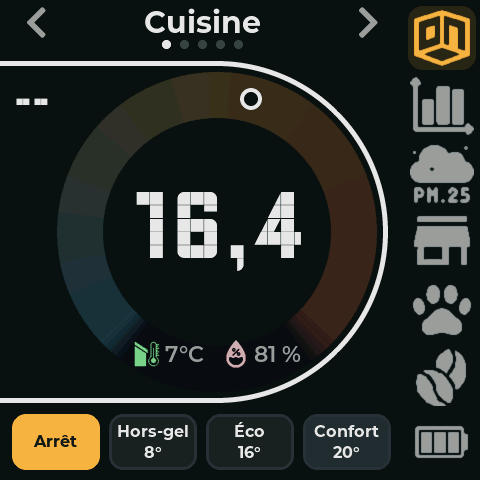
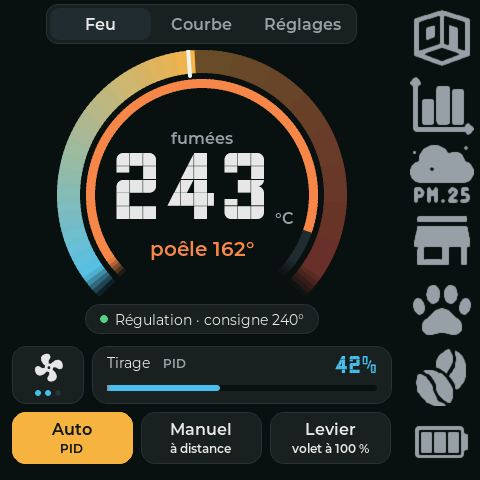
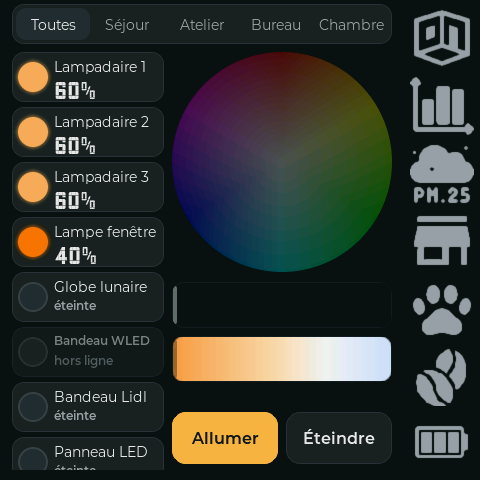
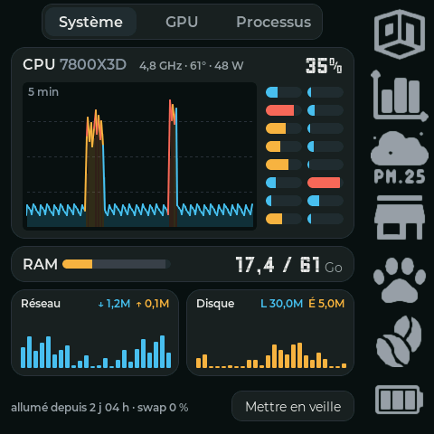
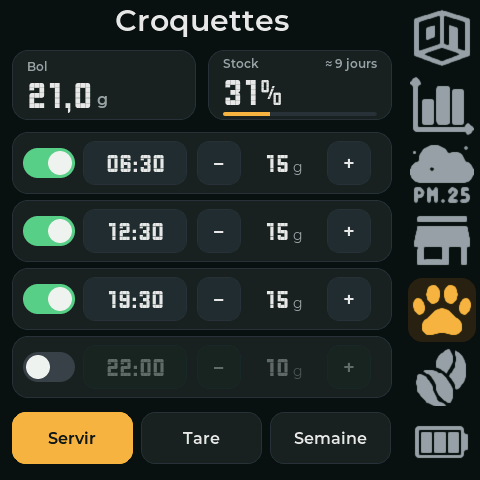
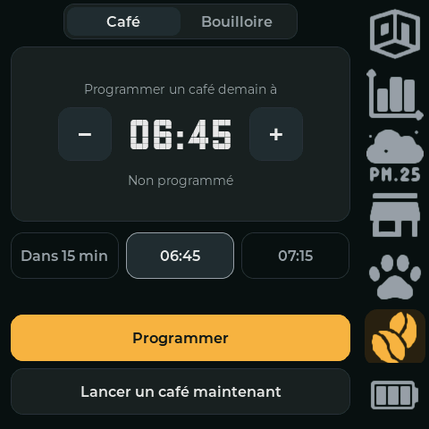
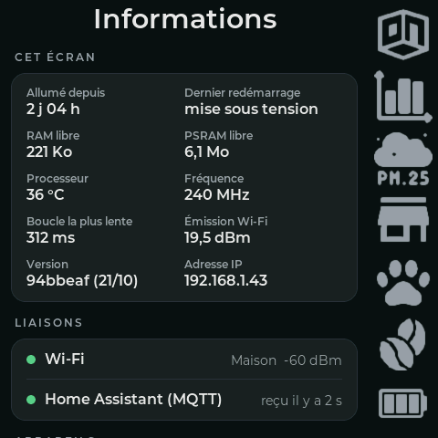
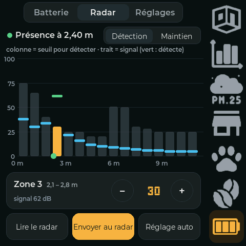
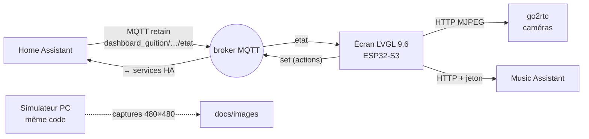

# Dashboard Guition — écran mural LVGL pour Home Assistant

Tableau de bord mural pour écrans **Guition ESP32-S3-4848S040** : firmware LVGL 9.6, piloté par
**Home Assistant via MQTT**, avec un **simulateur PC** qui compile le vrai code des pages et sort des
captures 480 × 480. Dix-huit pages tactiles pensées pour la maison : chauffage, graphes 24 h,
qualité de l'air, ouvrants, croquettes, café, eau chaude, VMC, poêle à bois, musique, lumières,
panneau LED, imprimante 3D, PC, réglages, informations, batterie — plus la page radar des écrans
sur batterie.

**EN.** Wall-mounted dashboard for Guition ESP32-S3-4848S040 screens: an LVGL 9.6 firmware driven by
Home Assistant over MQTT, plus a PC simulator that compiles the very same page code and renders
480×480 captures. 18 touchscreen pages — heating, hot water, VMC, wood stove, music, lights,
3D printer, PC, air quality, and more.

[](LICENSE)
[](lib/lvgl-9.6.0)
[](board/esp32-s3-devkitc-1-n16r8v.json)
[](platformio.ini)
[](CONTRAT_MQTT.md)

---

L'anneau du chauffage pendant la montée en température (9 images du simulateur, animées) :



## Galerie

Rendu réel du code, capturé par le simulateur (`make -C simu`) :

<table>
  <tr>
    <td><br><b>Chauffage</b> — 16,4° mesurés, consigne 20° à l'anneau, lueur de chauffe, modes arrêt / hors-gel / éco / confort</td>
    <td><br><b>Eau chaude</b> — ballon, consigne à l'anneau, chauffe forcée, courbe 24 h</td>
    <td><br><b>VMC</b> — petite / grande vitesse par zone, hygro en direct, hélices animées (GIF : un tour complet de la grande vitesse, 900 ms)</td>
    <td><br><b>Poêle à bois</b> — régulation du tirage au PID sur la température des fumées, alerte recharge, courbes</td>
  </tr>
  <tr>
    <td><br><b>Musique</b> — Music Assistant : lecture, bibliothèque, albums, radios, sortie</td>
    <td><br><b>Lumières</b> — disque chromatique, luminance, température de couleur</td>
    <td><br><b>Imprimante 3D</b> — fichiers STL et vignettes d'impression, suivi de la couche en cours</td>
    <td><br><b>PC</b> — système, GPU, processus, IA locale, mise en veille</td>
  </tr>
</table>

<details>
<summary>Les autres pages (cliquer pour déplier)</summary>
<table>
  <tr>
    <td><br><b>Graphes</b> — 24 h glissantes, lecture au doigt, valeur du jour en ambre</td>
    <td><br><b>Qualité de l'air</b> — deux purificateurs, PM1/PM2,5/PM10 colorés selon le niveau</td>
    <td><br><b>Ouvrants</b> — store, volet, toile de projection, réglage au doigt</td>
    <td><br><b>Croquettes</b> — distributeur : bol, stock, 4 repas, semaine</td>
  </tr>
  <tr>
    <td><br><b>Café</b> — machine et bouilloire : programmation, températures</td>
    <td><br><b>Panneau LED</b> — séances lumineuses : intensités, longueurs d'onde, minuterie</td>
    <td><br><b>Réglages</b> — luminosité jour/nuit, veille, pièce de l'écran, Wi-Fi</td>
    <td><br><b>Informations</b> — santé de l'écran, liaisons au vert ou au rouge, journal</td>
  </tr>
  <tr>
    <td><br><b>Batterie</b> — écran sur batterie : charge, réveils 24 h, latences Wi-Fi/MQTT</td>
    <td><br><b>Radar</b> — capteur micro-ondes LD2410S : zones, sensibilité, test sur place</td>
  </tr>
</table>

</details>

## Navigation

Le rail de droite est un **carrousel d'icônes** défilable au doigt : 16 icônes de 64 px dans une
colonne de 76 px, sans aimantation ni élastique — il s'arrête pile sur la première et la dernière.
Ce GIF, fabriqué par le simulateur aux instants réels du geste (30 ms par pas du glissé, puis 50 ms
pendant l'élan), montre le glissé, l'élan qui s'éteint, puis l'appui sur l'icône Imprimante 3D :
la page change d'un coup, le rail ne bouge pas. La page épinglée (ici la batterie, à 12 %) reste
fixe en bas, sous le carrousel.


Pendant que le rail bouge, le **flux caméra se met en pause** et ne repart que 300 ms après l'arrêt
(`RAIL_REPRISE_MS`, [src/ui_lvgl/ui_shell.cpp](src/ui_lvgl/ui_shell.cpp)) : mesuré sur l'écran, une
relance entre deux pas de l'élan espaçait les pas (47 → 135-300 ms) et étirait l'élan de 0,4-0,8 s
à 1,4-3 s — la caméra hachait le geste.

## Matériel

- Écran **Guition ESP32-S3-4848S040** (4", 480 × 480) : module **ESP32-S3 N16R8V** (16 Mo flash, 8 Mo PSRAM),
  dalle **ST7701S** pilotée en RGB, tactile capacitif **GT911**.
- Le pilote d'affichage est fourni par [LovyanGFX](https://github.com/lovyan03/LovyanGFX)
  (classe `Panel_ST7701_guition_esp32_4848S040`, voir [include/LGFX_ESP32S3_RGB_TFT_SPI_ST7701_GT911.h](include/LGFX_ESP32S3_RGB_TFT_SPI_ST7701_GT911.h)).
- Carte PlatformIO : [board/esp32-s3-devkitc-1-n16r8v.json](board/esp32-s3-devkitc-1-n16r8v.json)
  (devkitc-1, 16 Mo / 8 Mo). Partitions : `large_spiffs_16MB.csv`, ~10 Mo de LittleFS.
- Alimentation : 5 V (les écrans sur batterie ajoutent un module batterie + radar HLK-LD2410S).
- Sur ces puces, les eFuses verrouillent la flash en **DIO** (2 fils) : les tentatives QIO/QOUT retombent
  en DIO au démarrage — documenté dans les commentaires de [platformio.ini](platformio.ini).

Mesuré sur cette branche (8/11/2026) : **Flash 56,0 %** (2 641 031 o / 4 718 592 o), **RAM interne 25,1 %**
(82 160 o / 327 680 o), image finale 2 677 199 o.

## Architecture



- **L'écran ne parle qu'à HA, par MQTT** (une seule forme pour toutes les pages : `etat` retenu
  HA → écran, `set` écran → HA). Le détail topic par topic est dans [CONTRAT_MQTT.md](CONTRAT_MQTT.md).
  Seules exceptions : les images lourdes (flux caméra, miniatures, pochettes), chargées en HTTP.
- **Un seul environnement de compilation pour toute la production** (`ecran`) : chaque écran se
  reconnaît à son **adresse Wi-Fi MAC**, table `ECRANS[]` de [src/ecran/ecran.cpp](src/ecran/ecran.cpp)
  (nom de la pièce, IP statique, rotation, batterie). Les écrans prennent une IP statique
  (`RESEAU_OCTET_*` + dernier octet) pour qu'OTA et banc fonctionnent toujours.
- **LVGL 9.6.0 est vendorisée** dans [lib/lvgl-9.6.0](lib/lvgl-9.6.0), allégée (sans docs ni exemples)
  et **patchée à la main** : le correctif de défilement `scroll_bande_9.6.patch` est appliqué
  (marqueur `.bande-applique`) ; les deux autres patchs de `docs/patches/` sont protégés par des
  drapeaux de compilation et non appliqués.
- **Build hybride pioarduino** : plateforme figée `55.03.312-1` (Arduino 3.3.12 / ESP-IDF 5.5.5),
  `custom_sdkconfig` pour le Wi-Fi (fenêtre TCP 32 Ko, IRAM). Le fichier `include/version_git.h`
  (commit affiché page Infos) est écrit par `version_git.py` avant chaque compilation.
- Codage en **C++ avec identifiants français** : c'est le choix du projet, assumé et homogène.

## Sous le capot

Tous les chiffres cités ci-dessous ont été mesurés, soit sur l'écran (banc PC ⇄ écran, séries A-B-A,
captures comparées à l'octet), soit au simulateur. Seuls les mécanismes et la trace de leur mesure en
commentaire sont publiés dans ce dépôt ; les journaux de campagne complets sont restés hors du dépôt
public.

- **Défilement « par bande », la LVGL patchée.** Quand un conteneur défile, LVGL repeint toute son
  aire : mesuré en 9.6 brute, **175 336 px par pas de geste** (le conteneur 404 × 434 entier). Le
  [scroll_bande_9.6.patch](docs/patches/scroll_bande_9.6.patch), appliqué à la librairie vendorisée
  (marqueur `.bande-applique`), décale la mémoire d'image du déplacement réellement appliqué et ne
  repeint que deux bandes, entrée et sortie : sur l'écran, **7 676 px et 61 → 9 ms** d'image médiane
  (commande de banc `/defiler`, 30 pas, 180 mesures). Une image de réparation pleine aire part 150 ms
  après le dernier pas. L'éligibilité se statue à la création du conteneur
  ([src/ui_lvgl/ui_theme.cpp](src/ui_lvgl/ui_theme.cpp), `ui_defilement_rapide`) : une exclusion en
  cours de geste ne défait pas les images déjà sautées — chiffrée un temps en 8.4 à 84 images /
  3 712 609 px de pixels orphelins.
- **Rotation 0, deux mémoires d'image en PSRAM.** Toute la production tourne en rotation 0 : le pilote
  LovyanGFX alloue deux imagebuffers plein écran, LVGL dessine dans celui qui n'est pas montré, la
  dalle bascule au VSYNC — plus de copie vers la dalle (mesuré : 51 ms, pire 81, page Informations)
  et **77 ko de RAM interne rendus** ([src/ecran/ecran.cpp](src/ecran/ecran.cpp)). C'est la condition
  du chemin rapide : sans mémoire à décaler, rien à décaler. Le mode direct à une seule mémoire a été
  essayé et refusé à l'usage (clignotement et déchirure).
- **L'anneau du thermostat : 75 → 24 ms par pas.** L'anneau est décrit élément par élément (135
  segments de 2°, fondus, bouts arrondis, point de la pièce), chacun avec son rectangle d'impact ;
  seule la zone qui change est invalidée (`anneau_invalider`). Mesuré sur l'écran en A-B-A pendant une
  glisse de consigne par pas de 0,5° : **75,5 → 24,0 ms** médians par pas (−68 %),
  **108 900 → ~32 500 px** repeints par pas. Le simulateur a validé l'identité des pixels avant/après.
- **Le même patron sur les graphes.** La lecture au doigt du graphe 24 h repeignait **119 086 px en
  103 ms** par pas de doigt (mesuré) ; ne repeindre que les deux colonnes du curseur et l'ancienne
  place de la bulle l'a ramenée à ~45 ms. Idem sur les courbes : ballon **106 → 30 ms**, poêle
  **51 → 24 ms** par image (écran, A/B).
- **La lueur de chauffe est tramée et précalculée.** Le halo rouge sous l'anneau est une image de
  232 × 232 px (**161 472 o**) calculée une fois, RGB565 + masque alpha planaire, en **trame ordonnée
  (Bayer 4×4)** : le RGB565 n'offre qu'une vingtaine de niveaux de rouge, sans trame les marches sont
  visibles. C'est un choix d'aspect, pas de vitesse.
- **La caméra rend tout à la fermeture.** Les tampons d'image MJPEG (2 × 460 800 o), les tampons JPEG
  (3 × 250 000 o), la bande de décodage, les calques de capture d'éléments et les piles des tâches de
  fond sont rendus quand la caméra se ferme : **1,67 Mo de tampons** — mesuré sur l'écran, PSRAM libre
  **4,07 → 5,88 Mo** et RAM interne **87 → 113 ko** dès la fermeture. Les tâches de fond se suppriment
  elles-mêmes, jamais tuées de l'extérieur : on les surprendrait en plein `recv()`. Côté flux : la
  fenêtre TCP portée de 5 760 o à **32 ko** a donné **15,3 à 15,9 images différentes par seconde** (4,5
  au départ) ; un flux MJPEG jamais refermé saturait **22 des 32 tampons de réception Wi-Fi** et
  rendait l'écran sourd (MQTT et banc muets) — l'ouverture/fermeture propre du flux est un correctif
  visible dans [src/ui_lvgl/ui_camera.cpp](src/ui_lvgl/ui_camera.cpp).
- **Migration LVGL 8.4 → 9.6 : trois patchs, des leçons consignées dans le code.** Première
  compilation en 9.6 : **295 erreurs dans 40 sources**. La librairie vendorisée porte trois patchs
  ([docs/patches/](docs/patches/)) : le chemin rapide de défilement (appliqué), la sonde
  d'invalidation et la mesure de profondeur de pile (protégés par drapeaux de compilation, non
  appliqués). Les pièges rencontrés, tous tracés en commentaire dans les sources : la 9.6 ne prend plus
  son horloge dans la configuration — sans `lv_tick_set_cb`, plus rien ne se rafraîchit ; le boutisme —
  sans `LV_COLOR_FORMAT_RGB565_SWAPPED` sur l'écran et les deux mémoires, rouge et bleu sont permutés
  sur la dalle ; `lodepng_decode32` ne rend plus des pixels mais un descripteur — mal lu, il coûtait
  **4,44 Mo de PSRAM** perdus, récupérés ; l'allocateur n'envoie en PSRAM que les blocs de plus de
  **512 o** (`heap_caps_malloc_extmem_enable`), sinon le tas interne suffoque.
- **Le simulateur PC ne ment pas, mais il ne chronomètre pas.** Il compile les VRAIES sources des
  pages, avec la même configuration, et produit ~280 captures 480 × 480 : identité des pixels au comparatif
  octet à octet entre deux binaires, appels de dessin et pixels invalidés comptés par primitive,
  scénario complet sous AddressSanitizer/UBSan (zéro rapport). Mais ses microsecondes sont du temps PC,
  **300 à 600 fois** plus rapide que l'écran : tous les chiffres de ce README qui parlent de temps sont
  mesurés sur l'écran.
- **Chien de garde, dump du plantage précédent, banc.** Le chien de garde de la boucle est à **10 s** :
  un écran figé redémarre et dit où il était — l'étape en cours, ses repères et les dernières traces
  (anneau de 3 072 o) survivent en mémoire RTC et s'affichent page Informations. Le banc PC ne répond
  qu'à la machine désignée : HTTP **8080** (capture d'écran, appuis et glissés simulés), Telnet **23**
  (journal, dump du dernier plantage, sans redémarrer). Verrou non négociable : tout appui synthétique
  qui toucherait un objet cliquable est refusé (**403**) — d'où la route `/defiler`, qui défile sans
  jamais simuler de doigt.

## Démarrage rapide

### Prérequis

- [PlatformIO Core](https://platformio.org/install) (CLI `pio`).
- Un PC Linux avec `g++` et `zlib` pour le simulateur ; `python3` (et `pillow` pour `tools/banc.py`).
- Un broker MQTT et Home Assistant avec l'intégration MQTT.

### 1. Configurer les secrets

Les fichiers de secrets ne sont **pas** dans le dépôt — copiez les gabarits et remplissez-les :

```bash
cp src/secrets_mqtt.h.exemple  src/secrets_mqtt.h          # broker, utilisateur, mot de passe
cp src/secrets_ma.h.exemple    src/secrets_ma.h            # serveur et jeton Music Assistant
cp src/ecran/secrets_wifi.h.exemple src/ecran/secrets_wifi.h  # SSID, mot de passe, plan d'IP local
```

### 2. Déclarer ses écrans

Dans [src/ecran/ecran.cpp](src/ecran/ecran.cpp), la table `ECRANS[]` associe chaque écran à sa MAC :

```c
static const ecran_t ECRANS[] = {
    // { MAC (placeholder), dernier octet de l'IP, pièce, rotation, batterie }
    {{0xaa, 0xbb, 0xcc, 0x00, 0x00, 0x01}, 10, "cuisine",  0, false},
    {{0xaa, 0xbb, 0xcc, 0x00, 0x00, 0x02}, 11, "sejour",   0, true },
    // … remplacez les MAC par celles de vos écrans — la trace [ecran] du premier démarrage les affiche (pio device monitor)
};
```

Les adresses du dépôt sont des **placeholders** : mettez vos MAC, et l'IP statique se construit
avec `RESEAU_OCTET_1/2/3` + le dernier octet déclaré.

### 3. Compiler et flasher

```bash
pio device list                                             # trouve ton port série (ttyACM0 ou ttyUSB0 selon le câble)
pio run -e ecran-usb -t upload --upload-port /dev/ttyACM0    # premier flash : par câble (ou /dev/ttyUSB0)
pio run -e ecran -t upload --upload-port 192.168.1.41        # ensuite : OTA, sans câble
pio device monitor                                          # journal série, 115 200 bauds
```

L'OTA passe par `ArduinoOTA` (protocole d'upload `espota` du dépôt, 15 s de timeout) : une fois le
premier flash fait par câble, plus besoin d'ouvrir l'écran. L'environnement `banc-chambre1-v9` est
réservé aux mesures de rendu — ne pas le flasher sans savoir pourquoi.

### 4. Home Assistant

Le contrat complet (topics, JSON, conventions) tient dans [CONTRAT_MQTT.md](CONTRAT_MQTT.md) :
deux automatisations par page (« Écran · page · état » qui publie `etat` en retain, « Écran · page ·
commandes » qui exécute les `set`). [ha_propositions/](ha_propositions/) contient **23 automatisations
prêtes à l'emploi** pour HA (les miennes, adaptées : remplacez les entités d'exemple par les vôtres).
La page Musique ne passe pas par MQTT : l'écran parle directement à **Music Assistant** (HTTP + jeton).

### 5. Simulateur PC

```bash
make -C simu                 # compile le VRAI code des pages, joue le scénario, écrit simu/captures/*.png
make -C simu asan            # mêmes pages sous AddressSanitizer / UBSan
python3 simu/galerie.py galerie.html   # assemble les captures en une page HTML consultable
```

Le simulateur rejoue les messages MQTT d'un relevé réel anonymisé ([simu/donnees/](simu/donnees/))
et produit ~280 captures, dont les images des trois GIF de cette page. C'est lui qui a fabriqué la
galerie ci-dessus — le code affiché est
bit à bit celui de l'écran (mêmes sources, même `lv_conf.h`, couleurs 16 bits).

## Outillage

| Outil | Usage |
|---|---|
| [tools/banc.py](tools/banc.py) | piloter un écran réel depuis le PC : capture PNG, appuis/glissés simulés, journal Telnet, dump de plantage (HTTP :8080, réservé au PC `RESEAU_PC`) |
| [tools/guetter_dumps.py](tools/guetter_dumps.py) | espionner les topics `dashboard_guition/` du broker (paho-mqtt 1.x) |
| [tools/gen_conf_v9.py](tools/gen_conf_v9.py) | régénère `conf_v9/lv_conf.h` depuis le gabarit LVGL 9.6 |
| [tools/polices_ui.sh](tools/polices_ui.sh) | régénère les polices Montserrat / K-Type 3x5 (`lv_font_conv`) |
| [tools/icon2lvgl.py](tools/icon2lvgl.py) · [tools/creer_ico_mdi.py](tools/creer_ico_mdi.py) | convertir des icônes SVG/PNG en descripteurs LVGL (les sources Material Design Icons sont dans `tools/mdi/`) |
| [tools/comparer_captures.py](tools/comparer_captures.py) | diff image à image entre deux jeux de captures |

## Ajouter une page

1. Créer `src/ui_lvgl/page_x.cpp` sur le gabarit des autres : `page_x_creer(parent)` /
   `page_x_quitter()`, à partir de n'importe quelle page existante.
2. L'ajouter à la table `pages[]` de [src/ecran/ecran.cpp](src/ecran/ecran.cpp) (icône, titre,
   fonctions) — le rail de droite se met à jour tout seul.
3. Définir le contrat d'abord : ajouter la section dans [CONTRAT_MQTT.md](CONTRAT_MQTT.md)
   (`etat` / `set`), puis l'automatisation côté HA sur le gabarit de `ha_propositions/`.
4. Vérifier au simulateur : ajouter un état dans `simu/donnees/` et une capture au scénario
   (`simu/simu.cpp`), `make -C simu`.

## Diagnostics

- **Journal série** : `pio device monitor` (115 200 bauds).
- **Journal à distance** : Telnet sur le port 23 de l'écran, sans redémarrer —
  `python3 tools/banc.py journal 60`.
- **Banc PC** : HTTP sur le port 8080, réservé à la machine `RESEAU_PC` — capture d'écran,
  appuis simulés, traces, dump du dernier plantage (`tools/banc.py dump`).
- **Chien de garde** : redémarre la boucle figée ; la raison du redémarrage et le plantage
  précédent s'affichent page Informations.
- **Page Informations** : santé (RAM/PSRAM, température CPU, version git), liaison MQTT/Wi-Fi au
  vert ou au rouge, journal des événements.

## Limites connues

- **Pensé pour un réseau local de confiance** : MQTT en 1883 sans TLS, OTA sans mot de passe,
  caméra en MJPEG HTTP. À ne pas exposer sur Internet.
- LVGL 9.6 vendorisée et patchée : ne pas la remplacer par la version du registre sans rejouer
  `docs/patches/scroll_bande_9.6.patch` (le défilement par bande est ce qui fait la fluidité).
- Flash verrouillée en DIO par eFuse sur ces modules N16R8V (voir platformio.ini).
- Les captures du simulateur utilisent des images de démonstration synthétiques (caméras, pochettes,
  logos) : remplacez `simu/donnees/cameras|pochettes|logos` par vos propres images pour vos essais.
- L'automatisation « PC » suppose un petit agent publiant `dashboard_guition/pc/*` (contract
  documenté, agent non fourni).

## Arborescence

```
board/           json de carte (esp32-s3-devkitc-1-n16r8v)
conf_v9/         lv_conf.h LVGL 9.6 (généré par tools/gen_conf_v9.py)
docs/images/     galerie (captures du simulateur) · docs/patches/ patchs LVGL
ha_propositions/ 23 automatisations Home Assistant (YAML)
include/         wrapper LovyanGFX de la dalle, en-têtes communs
lib/             ressources (polices/images), icones, lvgl-9.6.0 patchée + bibliothèques amont
simu/            simulateur PC (Makefile, scénario, données MQTT relevées et anonymisées)
src/ecran/       firmware : Wi-Fi, table ECRANS[], OTA, banc distant, diagnostics
src/ui_lvgl/     les 18 pages LVGL + shell, graphes, MQTT, caméra, musique…
tools/           banc PC, convertisseurs d'icônes/polices, guetteur MQTT
CONTRAT_MQTT.md  contrat MQTT complet (la référence)
```

## Licence et crédits

Code de ce dépôt : **MIT** ([LICENSE](LICENSE)). Bibliothèques incluses dans `lib/` :

| Bibliothèque | Licence |
|---|---|
| [LVGL 9.6.0](https://lvgl.io) (vendorisée, patchée) | MIT |
| [LovyanGFX 1.2.19](https://github.com/lovyan03/LovyanGFX) | FreeBSD 2 clauses (lu dans `license.txt`) |
| [ArduinoJson 7.4.2](https://arduinojson.org) | MIT |
| [PubSubClient](https://pubsubclient.knolleary.net) | MIT |
| [ESP32Ping](https://github.com/marian-craciunescu/ESP32Ping) | LGPL 2.1 |
| [JPEGDEC 1.8.4](https://github.com/bitbank2/JPEGDEC) (simulateur) | Apache 2.0 |
| [HLK-LD2410S](https://github.com/phuongnamzz/HLK-LD2410S) (driver radar modifié) | MIT |

Polices et icônes : les polices sources — [Montserrat](https://fonts.google.com/specimen/Montserrat)
(SIL OFL 1.1), « 3x5 » de [K-Type](https://ktype.co.uk) (gratuite à l'usage, conditions de
redistribution à vérifier chez l'auteur), [FontAwesome 5 Free](https://fontawesome.com) (OFL, icônes
CC BY 4.0) — ne sont **pas redistribuées** dans le dépôt : voir [tools/fonts/README.md](tools/fonts/README.md)
pour les récupérer et régénérer les polices bitmap (`lib/ressources/*.c`, dans le dépôt). Sources
d'icônes [Material Design Icons](https://pictogrammers.com/library/mdi/) (Apache 2.0) dans
`tools/mdi/`. Les images de démonstration du simulateur (caméras, pochettes, logos) sont des mires
générées, libres de droit.
