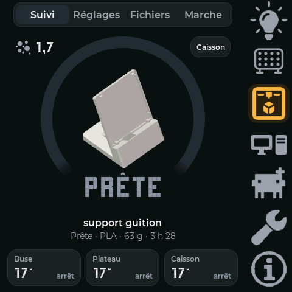
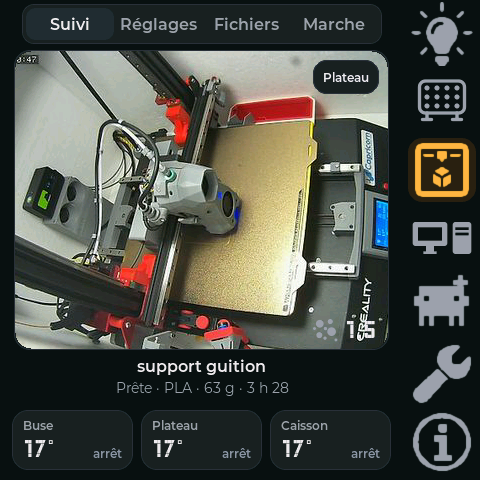
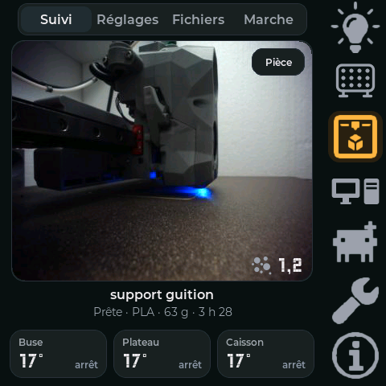

# Page Imprimante 3D — ce qu'il vous faut, quoi activer

[English](en/IMPRIMANTE.md) | **Français**

La page Imprimante 3D (icône imprimante dans le rail) montre l'état d'une imprimante
**Klipper** pilotée par **Moonraker**, relayé par Home Assistant (contrat
[CONTRAT_MQTT.md](../CONTRAT_MQTT.md) § Imprimante 3D). Quatre onglets : **Suivi** (anneau de
progression autour de la miniature du slicer, températures, pastille de particules fines),
**Réglages** (préchauffes Arrêt/PLA/PETG/ABS, consignes buse/plateau/caisson, interrupteurs
Lumière/Filtration/Chauffage/Carte mère, mise à l'origine), **Fichiers** (les 12 plus récents avec
vignette, matière, durée — un appui ouvre l'aperçu et « Lancer »), **Marche** (allumer, éteindre,
pause, arrêt avec confirmation).

## Ce qu'il vous faut

- une imprimante sous **Klipper** avec **Moonraker** (Mainsail ou Fluidd, peu importe : ils ne
  servent pas ici, c'est Moonraker qui parle au broker) ;
- le **même broker MQTT** que celui des écrans (1883 local, sans TLS, comme partout dans le projet) ;
- **Home Assistant** avec les automatisations proposées (plus bas) ;
- un **slicer qui écrit des miniatures PNG 48×48 et 300×300** dans le G-code (OrcaSlicer le fait par
  défaut sur les profils Klipper ; réglages plus bas) ;
- **facultatif** : une ou deux caméras en **flux MJPEG** (go2rtc sur un NAS chez l'auteur).

## 1. Côté imprimante : activer MQTT dans Moonraker

Dans `moonraker.conf`, une section `[mqtt]`. Exemple minimal, options vérifiées dans la
[documentation de Moonraker](https://moonraker.readthedocs.io/en/latest/configuration/#mqtt) :

```ini
[mqtt]
address: 192.168.1.10        # votre broker (celui de Home Assistant)
port: 1883
instance_name: MON_IMPRIMANTE  # préfixe de tous les sujets ; le nom de l'auteur était CR10SPRO
publish_split_status: True   # un sujet par valeur : {instance}/klipper/state/{objet}/{champ}
status_objects:
  print_stats
  display_status=progress
  extruder=temperature,target
  heater_bed=temperature,target
  heater_generic Chauffage=temperature,target
  output_pin ENCLOSURE_LIGHT=value
  output_pin ALIM_CHAUFFAGE=value
  controller_fan FILTRATION_CAISSON=speed
```

- `instance_name` : **c'est « CR10SPRO » partout dans les YAML proposés** — c'était le nom d'instance
  de l'auteur. Mettez le vôtre, et remplacez `CR10SPRO` dans les trois YAML (sujets d'écoute du
  capteur, sujet de commande de l'automatisation).
- `status_objects` : seuls les objets listés sont publiés (la syntaxe `objet=champ,champ` est celle de
  la doc). Les noms `Chauffage`, `ENCLOSURE_LIGHT`, `ALIM_CHAUFFAGE`, `FILTRATION_CAISSON` sont ceux
  du `printer.cfg` de l'auteur : mettez les noms de **vos** objets, ou retirez les lignes
  correspondantes.
- Avec `publish_split_status: True`, chaque valeur part sur son propre sujet
  (`{instance}/klipper/state/{objet}/{champ}`, payload `{"eventtime":…, "value":…}`) — c'est ce que le
  capteur HA écoute. La valeur par défaut (`False`) publie tout sur un seul sujet
  `{instance}/klipper/status` : le YAML proposé ne le gère pas.
- Moonraker publie aussi son statut en retenu : `{instance}/moonraker/status`
  (`{"server":"online"}` à la connexion, `{"server":"offline"}` via le message de ultime volonté —
  [source du composant mqtt](https://github.com/Arksine/moonraker/blob/master/moonraker/components/mqtt.py)).
  C'est ce qui dit si l'imprimante est « allumée » côté logiciel.
- `enable_moonraker_api` (défaut `True`) : les commandes JSON-RPC entrent par
  `{instance}/moonraker/api/request`.

Redémarrez Moonraker ; vérifiez dans son journal (`[mqtt] connecting…`) et côté broker
(`mosquitto_sub -t 'MON_IMPRIMANTE/#'`).

## 2. Côté Home Assistant : les trois YAML

Dans [ha_propositions/](../ha_propositions/), trois fichiers (à intégrer chez vous, après relecture —
remplacez `CR10SPRO`, les IP `192.168.1.30` et les entités d'exemple par les vôtres) :

1. [imprimante_configuration.yaml](../ha_propositions/imprimante_configuration.yaml) — dans
   `configuration.yaml` : un seul capteur template (`sensor.ecran_etat_klipper`) écoute
   `{instance}/klipper/state/#` + `{instance}/moonraker/status` et garde les valeurs utiles dans un
   attribut (températures : une publication par seconde, exclu du recorder).
2. [imprimante_dashboard_guition.yaml](../ha_propositions/imprimante_dashboard_guition.yaml) — dans
   `automations.yaml` : « Écran · imprimante · état » (publie `dashboard_guition/imprimante/etat` en
   retenu) et « Écran · imprimante · commandes » (reçoit `dashboard_guition/imprimante/set`,
   bornées).
3. [imprimante_fichiers.yaml](../ha_propositions/imprimante_fichiers.yaml) — la liste des fichiers :
   un `rest_command` vers Moonraker (`/server/files/list`, `/server/files/metadata`), puis un sujet
   retenu par fichier (`imprimante/fichiers/0` à `/11`, 0 = le plus récent).

Il vous faut aussi **deux scripts HA que vous écrivez vous-même** : `script.allumer_imprimante` et
`script.eteindre_imprimante`. Chez l'auteur ils pilotent une prise connectée (relais Zigbee qui coupe
l'alimentation de la machine) ; « éteindre » = arrêt propre de Klipper d'abord, puis coupure de la
prise. Sans ces scripts, les boutons Allumer/Éteindre de l'onglet Marche ne font rien.

## 3. Miniatures : les deux tailles, générées par le slicer

Le firmware ne dessine pas de miniature : il télécharge les PNG que le **slicer** a écrits dans le
G-code et que **Moonraker extrait** dans `gcodes/.thumbs/<fichier sans extension>-48x48.png` et
`-300x300.png`. L'écran construit l'adresse lui-même (base publiée par le YAML fichiers + nom du
fichier encodé + `-48x48.png` pour la liste, `-300x300.png` pour l'anneau, réduite au téléchargement).

Réglez les tailles dans votre slicer :

- **OrcaSlicer** : réglage `thumbnails` (Printer Settings, mode avancé), la valeur
  `48x48/PNG,300x300/PNG` — voir la [wiki OrcaSlicer, Advanced Printer
  Settings](https://www.orcaslicer.com/wiki/printer_settings/basic%20information/printer_basic_information_advanced.html)
  (les profils Klipper l'incluent déjà : celui de l'auteur, « MyKlipper 0.4 nozzle », en faisait deux
  le 23/10).
- **PrusaSlicer / SuperSlicer** : champ « G-code thumbnails » du profil imprimante, même valeur
  `48x48/PNG, 300x300/PNG` — le [récapitulatif de la doc Fluidd](https://docs.fluidd.xyz/features/printing/)
  donne les chemins exacts des menus selon les versions.

Sans miniatures de ces tailles, la liste et l'anneau affichent « pas de miniature » — le reste
fonctionne.

## 4. Caméras (facultatif)

Les deux vues (caisson, plateau) sont des **flux MJPEG** — chez l'auteur, go2rtc sur le NAS
(recadrage et sous-flux préparés sur place, ~384×304). Mesuré sur un écran (13/11) : caisson
≈ 18,7 images/s (558 et 561 images en 30 s, images de 30 Ko, décodage 52 ms — la source est réglée
à 20/s et l'écran la suit) ; plateau ≈ 14,4 images/s (433 images en 30 s, images de 14 Ko, décodage
39 ms — source autour de 14-15/s). La cadence dépend de chaque installation, mesure-la.
Les adresses sont dans
[src/ui_lvgl/ui_camera.h](../src/ui_lvgl/ui_camera.h) (`UI_CAM_IMPRIMANTE`, `UI_CAM_PLATEAU`,
remplaçables en `-D` à la compilation) : adaptez l'hôte, le port et le `src=`, puis recompilez.
Sans caméra (ou avec une URL fausse), le bouton d'angle continue de tourner les vues STL → caisson →
plateau ; la zone reste simplement vide (des traces `[camera]` passent en série/telnet, rien
d'affiché).

L'écran réel, avec ses trois vues — miniature du fichier, caisson, plateau (interface d'une version
antérieure ; images prises par la caméra de l'auteur, publiées avec son accord) :

  

## 5. Comment part une commande

L'écran publie sur `dashboard_guition/imprimante/set`, HA valide la liste des actions connues et
relance :

| Bouton | Ce qui part |
|---|---|
| Allumer / Éteindre | `script.allumer_imprimante` / `script.eteindre_imprimante` (à vous d'écrire) |
| Pause / Reprendre / Arrêter | `printer.print.pause` / `resume` / `cancel` (API MQTT de Moonraker) |
| Lancer (aperçu d'un fichier) | `printer.print.start` + nom du fichier |
| Préchauffes, +/− consignes | `printer.gcode.script` : M104 (buse), M140 (plateau), M141 (caisson), bornés |
| Lumière / Chauffage / Filtration | `SET_PIN PIN=ENCLOSURE_LIGHT`, `SET_PIN PIN=ALIM_CHAUFFAGE`, `SET_FAN_SPEED FAN=FILTRATION_CAISSON` (noms de votre `printer.cfg`) |
| Carte mère | `switch.turn_on/off` sur votre prise (ex. `switch.prise_zigbee_1`) |
| Mise à l'origine | `printer.gcode.script` G28 (bouton désactivé si imprimante éteinte ou impression en cours) |

Tout passe par `{instance}/moonraker/api/request` (JSON-RPC), comme le décrit la
[doc Moonraker](https://moonraker.readthedocs.io/en/latest/configuration/#mqtt).

## 6. Ce qui dépend de votre machine — et ce que la page affiche sans

| Dépendance | Sans, la page affiche… (lu dans le code) |
|---|---|
| Objet « caisson » (`heater_generic Chauffage`) | ligne Caisson à 0° (défaut du YAML) |
| `output_pin ENCLOSURE_LIGHT` / `ALIM_CHAUFFAGE`, `controller_fan FILTRATION_CAISSON` | interrupteurs Lumière/Chauffage/Filtration affichés, éteints ; les appuyer envoie un `SET_PIN`/`SET_FAN_SPEED` que Klipper rejette (silencieux à l'écran, erreur dans le journal Moonraker) |
| Wattmètre de la prise (`sensor.prise_imprimante_puissance` dans le YAML d'exemple) | « -- » à la place des watts (onglet Marche) |
| Capteur de particules fines (`sensor.aqm_pm1`) | « -- » sur la pastille PM du Suivi |
| Prise « carte mère » (`switch.prise_zigbee_1`) | champ carte mère à 0 ; remplacez par votre entité |
| Miniatures du slicer | « pas de miniature » (liste et anneau) |
| Caméras | zone caméra vide, voir § 4 |

## 7. Sans imprimante du tout

La page **ne se cache pas** : le rail est une liste fixe de pages
([src/ecran/ecran.cpp](../src/ecran/ecran.cpp), tableau `pages[]`). Sans message reçu, l'état par
défaut est « éteinte » : Suivi affiche « Imprimante éteinte », l'onglet Marche « Éteinte » avec le
bouton « Allumer l'imprimante » — qui publie une commande que personne n'exécute si vous n'avez pas
mis les automatisations. Pour retirer la page du rail, il faut retirer sa ligne dans `pages[]` et
recompiler (le simulateur, lui, peut aller sur n'importe quelle page).

## Voir aussi

- [CONTRAT_MQTT.md](../CONTRAT_MQTT.md) § Imprimante 3D — formats exacts des messages.
- [docs/INSTALLATION.md](INSTALLATION.md) § 4 — les automatisations HA en général.
- Simulateur : `make -C simu` capture les onglets (`simu/captures/45_imprimante.png`,
  `47_imprimante_reglages.png`, `48b_imprimante_apercu.png`).
