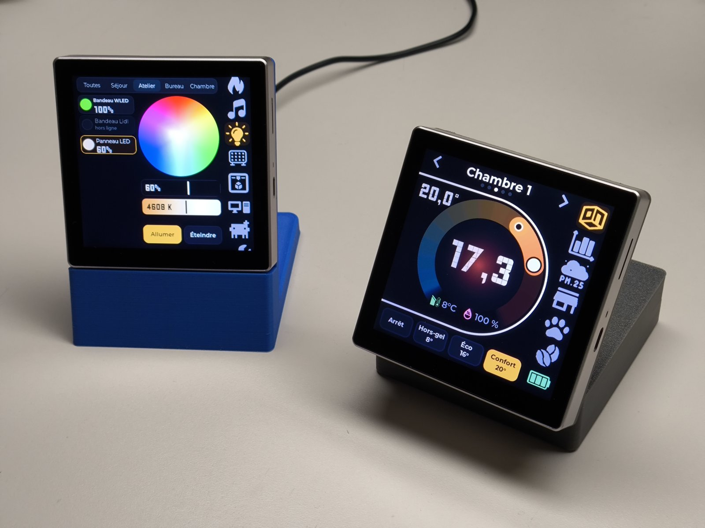
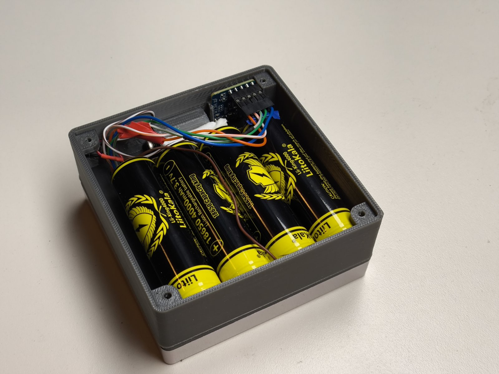
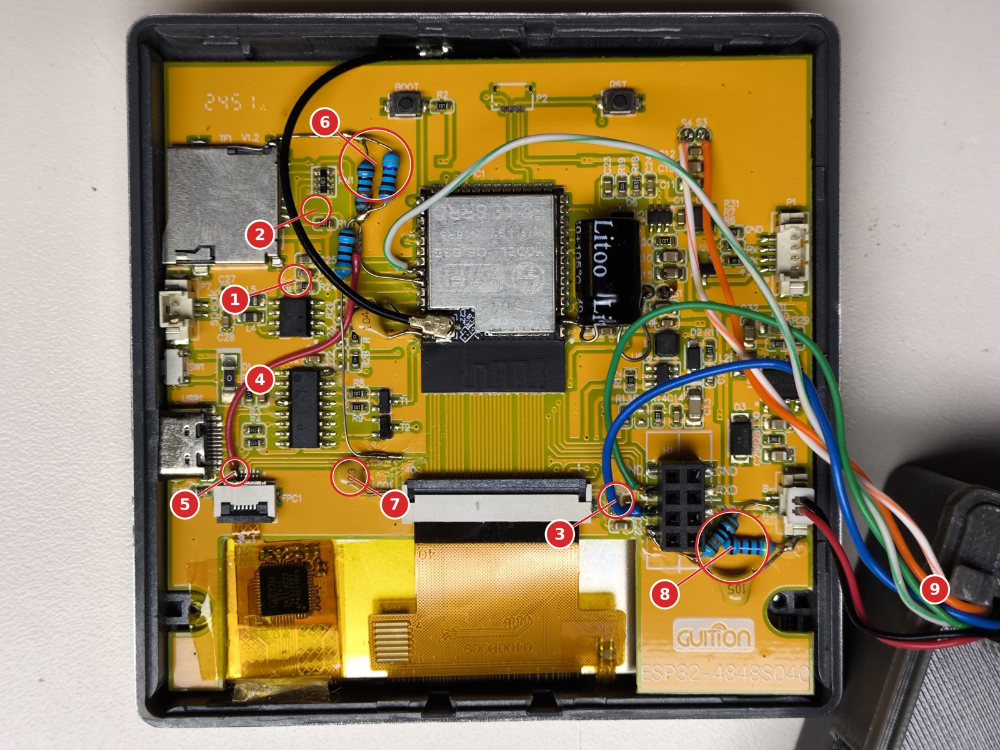
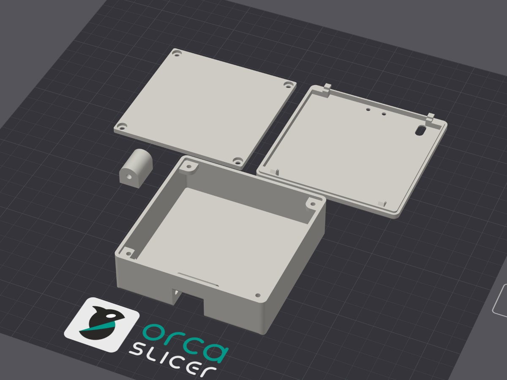

# Battery-powered display

**English** | [Français](README.md)

A variant of the Guition ESP32-S3-4848S040 display that runs **wire-free**: a lithium battery,
a presence radar that wakes the display when someone approaches, and firmware that spends most of
its time in deep sleep. It is the same firmware as the wall displays, with the “Battery & Sensor”
page on top.

## Hardware

| Item | Detail |
|---|---|
| Display | Guition ESP32-S3-4848S040 (the same as the wall displays) |
| Battery | 4 LiitoKala 18650 cells of 4000 mAh (rated), in parallel |
| Battery charging | the board's own charging circuit (battery connector) |
| Voltage measurement | 100 kΩ / 47 kΩ voltage divider on GPIO 1 (ADC), with a 1 µF capacitor ([ui_batterie_esp.cpp](../../src/ui_lvgl/ui_batterie_esp.cpp)) |
| Presence detection | 24 GHz **HLK-LD2410S** radar: OUT output on GPIO 2 (wakes the ESP32-S3 from deep sleep, ext0 wake); serial port on GPIO 41 (the ESP32's RX) and 40 (TX), 115,200 baud, for measurements and settings |
| Case | designed from A to Z, 4 parts printed in 3D: see [Case](#case) |

## Board modifications

The goal: free pins for the radar and the battery measurement, and leave nothing drawing current
during deep sleep.

1. **Amplifier power cut** (trace of its pin 6, VDD): see [The audio amplifier turned off](#the-audio-amplifier-turned-off).
2. **10 kΩ pull-up of the SD card's CS cut**, near the RN1 resistor network.
3. **Original reset removed**: its pull-up resistor and its capacitor.
4. **Red wire**: GPIO 42 powers the GT911 touch controller.
5. **GT911 power trace cut**, under the red wire's solder joint on the touch connector.
6. **Pull-down to ground**: two resistors in parallel on the GPIO 42 line.
7. **Delayed reset**: 10 nF capacitor (with its resistor) to the reset of the panel and the GT911.
8. **Battery measurement**: 100 kΩ / 47 kΩ voltage divider and 1 µF capacitor, on GPIO 1.
9. **Wires to the radar**, in the base.

### The reused pins

| GPIO | Original use | Use here |
|---|---|---|
| 1 | “relay” output of the Dupont header (amplifier BCLK, resistor not fitted) | battery measurement |
| 2 | “relay” output of the Dupont header (amplifier LRCLK, resistor not fitted) | radar OUT output, wake-up |
| 40 | “relay” output of the Dupont header (amplifier DIN, resistor not fitted) | TX to the radar |
| 41 | SD card MISO | RX from the radar |
| 42 | SD card CS | touch power and display reset (see below) |

The SD card can no longer be used.

### The wires to the radar (in the base)

| Wire | Radar side | Board side |
|---|---|---|
| blue | TX | GPIO 41 |
| green | RX | GPIO 40 |
| white/green | OUT | GPIO 2 |
| orange | 3.3 V | 3.3 V |
| white/orange | 0 V | GND |

### Touch and display off during sleep (GPIO 42)

GPIO 42 powers the GT911 touch controller directly (red wire, marker 4; the original power trace is
cut under the wire, marker 5). Through a resistor and a 10 nF capacitor, it also drives the shared reset of the panel and
the GT911, which is thus released with a slight delay. Two resistors in parallel to ground hold the line
low when the pin drives nothing (boot, sleep). The firmware sets it to 0 V before deep sleep and back to
3.3 V on wake.

For this pull-down to work, two pull-up resistors to 3.3 V are removed:

- the one of the display's **original reset** (with its capacitor), near the Dupont header (marker 3);
- the one of the **SD card's CS** (trace cut near the RN1 resistor network, marker 2).

### The audio amplifier turned off

The board's NS4168 amplifier is connected to no pin (its link resistors are not fitted), but it is
powered and enabled from the factory: it draws about **13 mA** at idle (datasheet), seven times the
display's whole deep-sleep current. Its power trace (pin 6, VDD) is cut (marker 1).

## Measured consumption

Measurements made with a lab power supply, at 3.7 V, whole display (radar included).

| Backlight | Processor | Wi-Fi | Current |
|---|---|---|---|
| 100 % | 240 MHz | always on | **390 mA** |
| 100 % | 80 MHz | power save (`PS_MIN`) | 320 mA |
| 100 % | 240 MHz | off | 330 mA |
| 100 % | 80 MHz | off | 310 mA |
| 5 % | 240 MHz | always on | 160 mA |
| 5 % | 80 MHz | power save (`PS_MIN`) | **100 mA** |
| Deep sleep | | | **2 mA** |

- The **backlight** is the largest item: about 230 mA between 5 % and 100 %.
- **Wi-Fi in power save** costs little: 320 mA against 310 mA with Wi-Fi off. Wi-Fi always on costs
  much more (about 60 mA at 5 %).
- In **deep sleep**, most of the current comes from the board's regulator. The touch controller is
  unpowered (I2C pull-ups measured at 0 V); the radar draws 68 µA at 0.5 Hz according to its manual (V1.04).

## Estimated battery life

Estimates based on the measurements above, for 4 18650 cells of 4000 mAh (rated capacity) in
parallel, i.e. 16,000 mAh. The real capacity is often lower and part of it cannot be used (cut-off
voltage, ageing): count 15 to 20 % less. The cells' self-discharge is not counted.

What each situation costs, default settings (economy after 10 s, sleep after 30 s):

| Situation | Cost |
|---|---|
| Deep sleep | 48 mAh per day |
| Someone walks by without touching (10 s on, then 20 s idle at 5 %) | ~1.6 mAh |
| Someone stays in the radar's field without touching (display idle at 5 %) | 100 mAh per hour |
| Use (backlight 100 %) | 6.5 mAh per minute |

| Typical use | Per day | Battery life |
|---|---|---|
| Sleep only | 48 mAh | ~330 days |
| 20 walk-bys a day | ~80 mAh | ~200 days |
| 20 walk-bys + 1 h of presence | ~180 mAh | ~90 days |
| 20 walk-bys + 3 h of presence + 15 min of use | ~480 mAh | ~34 days |

The time spent **in the radar's field** decides the battery life: the display stays awake as long as it
sees someone. Place it where people pass rather than where they sit, or adjust the radar's range (Radar
tab of the Battery page).

## What the firmware does to save power

- **Deep sleep** as soon as nobody is around, after the configured sleep delay: the panel goes into
  deep sleep (the ST7701's DSTB command), and the radar wakes it (GPIO 2).
- **Short boot** on wake: no startup screen, Wi-Fi endpoint and channel kept in RTC memory to
  reconnect without scanning. Measured: **0.69 to 0.72 s** until the screen is ready, against 1.39 s
  with the old firmware (on Arduino 2).
- **Music library on demand**: it is not loaded at startup, only when the list is opened.
- **Economy mode** after 10 s without touching: idle brightness, processor at 80 MHz, Wi-Fi in
  light power save (`WIFI_PS_MIN_MODEM`).
- **Wi-Fi off after synchronization** (option): the radio turns off once the data has been received
  from Home Assistant, and turns back on at the first touch. Measured gain small (10 mA at 80 MHz):
  `PS_MIN` power save already costs little.
- **Adjustable Wi-Fi transmit power** (option: 7 dBm, less current, less range).
- Tried without gain: `WIFI_PS_MAX_MODEM` (all the traffic is caught up at once on the radio's wake).

The **Battery & Sensor** page shows the charge, the wake-up history over 24 h (radar, touch,
timer) and the detail of the last wake-up, in milliseconds: Wi-Fi, MQTT, synchronization, cut-off.
The voltage is smoothed over 64 readings (the 4 extremes discarded); the charge is inferred from
the voltage (above 4.15 V).

## The radar library, modified

The [HLK-LD2410S](https://github.com/phuongnamzz/HLK-LD2410S) library is included in
[lib/HLK-LD2410S](../../lib/HLK-LD2410S), with these modifications (dated in comments in the code):

- **Compilation** with ESP-IDF 5: a `return` was missing.
- **Reliable commands**: the frame goes out in a single write (it used to go out in 19 pieces), and
  the reply is searched for by its header and the echo of the command, as in ESPHome. Before, it was
  read as a fixed-size block at the start of the buffer: a measurement frame arriving just before
  shifted it, and the switch to configuration missed on the first try. Up to 3 retries if the sensor
  does not answer.
- **Thresholds of the sensor's firmware 1.1.1**: 16 trigger thresholds and 16 hold thresholds,
  following its 2024 protocol (the library followed a 2023 manual).
- **Per-zone energy in dB**, like the Hi-Link tool, to compare it directly with the thresholds.
- **Automatic tuning**: it no longer waits indefinitely when the sensor stops sending its progress.
- **Measurement points** (raw frames, acknowledged commands, counters) for the log and the radar's
  web page.

## Case

Designed from A to Z in Fusion, for the display with its battery and the radar. Four parts, in STL
format (on GitHub, open a file: it displays in 3D):

| Part | File | Dimensions |
|---|---|---|
| Bottom case | [modeles/boitier_inferieur.stl](modeles/boitier_inferieur.stl) | 87.1 × 87.5 × 25.0 mm |
| Display back | [modeles/dos_ecran.stl](modeles/dos_ecran.stl) | 86.9 × 87.3 × 7.7 mm |
| Cover | [modeles/couvercle.stl](modeles/couvercle.stl) | 82.5 × 82.9 × 3.0 mm |
| Display pivot | [modeles/pivot_ecran.stl](modeles/pivot_ecran.stl) | 18.0 × 13.1 × 12.3 mm |

**License of the 3D files:** [Creative Commons BY-NC 4.0](https://creativecommons.org/licenses/by-nc/4.0/)
— free to print, modify and sharing with attribution, **no commercial use**. These files are not
covered by the code's MIT license (see [LICENSE](LICENSE)).
