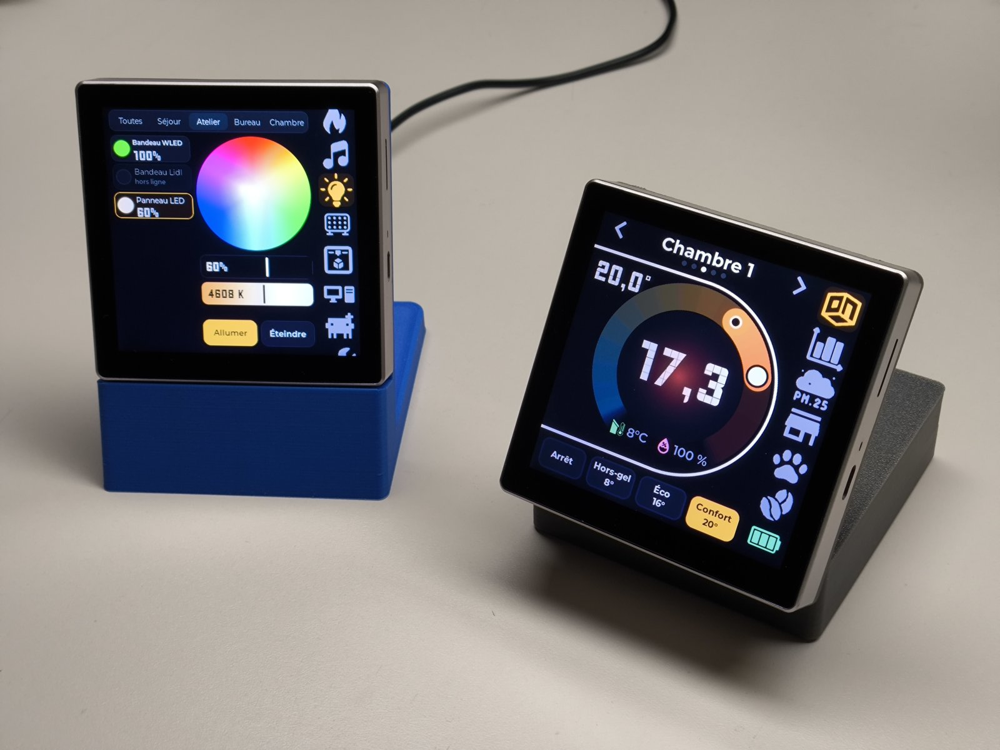
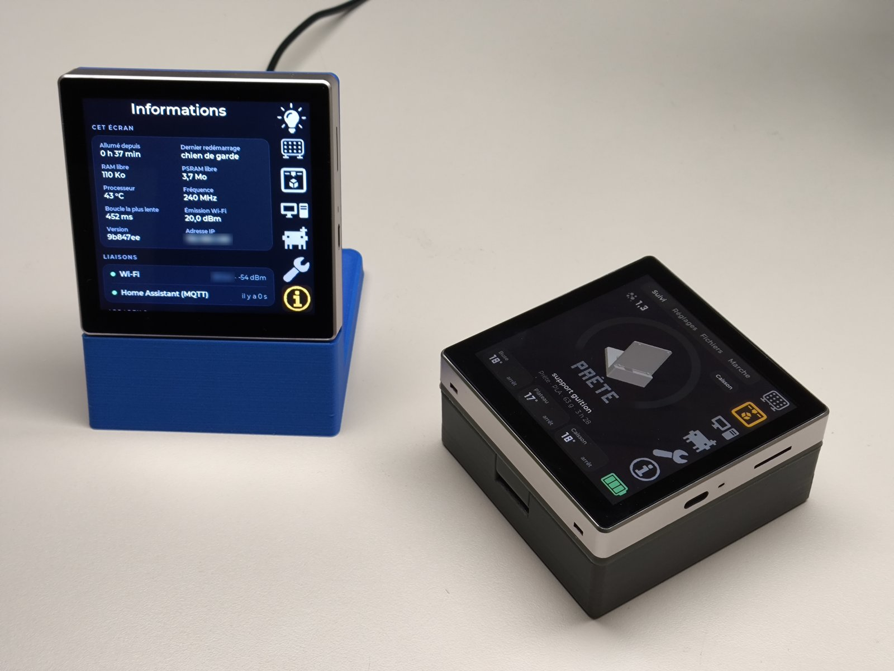
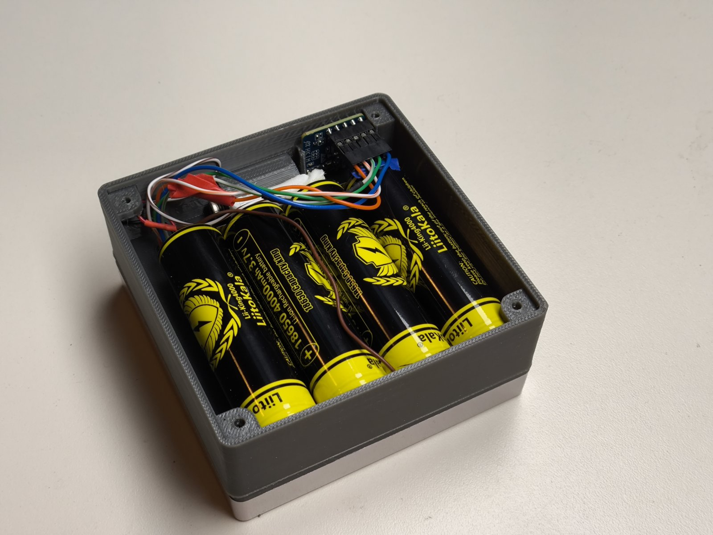
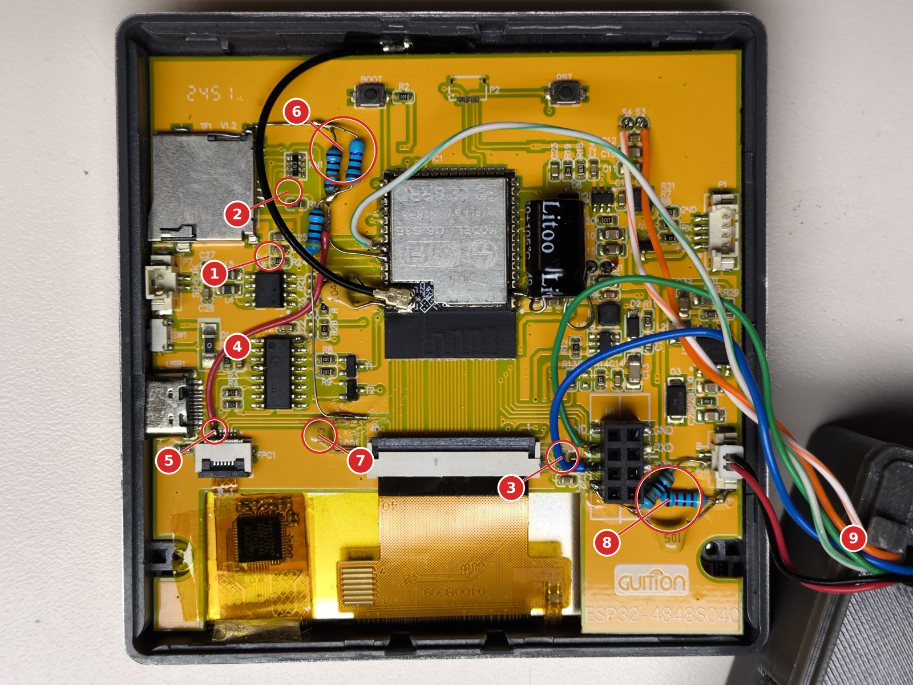
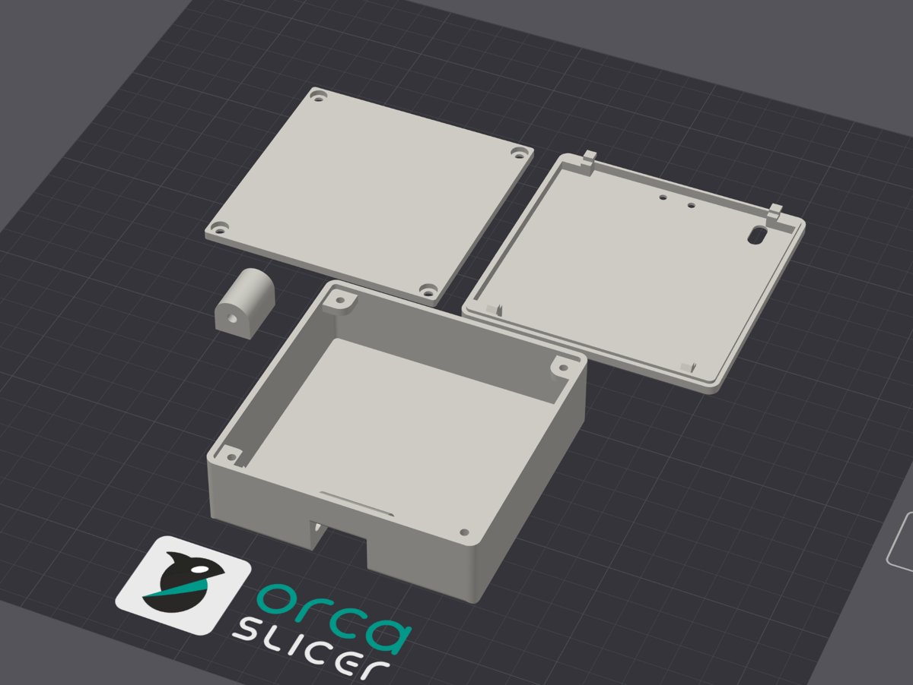

# Écran sur batterie

[English](README.en.md) | **Français**

Une variante de l'écran Guition ESP32-S3-4848S040 qui fonctionne **sans fil** : une batterie lithium,
un radar de présence qui réveille l'écran quand quelqu'un approche, et un firmware qui passe l'essentiel
de son temps en veille profonde. C'est le même firmware que les écrans muraux, avec la page « Batterie et
capteur » en plus.

## Matériel

| Élément | Détail |
|---|---|
| Écran | Guition ESP32-S3-4848S040 (le même que les écrans muraux) |
| Batterie | 4 cellules 18650 LiitoKala de 4000 mAh (annoncés), en parallèle |
| Charge de la batterie | circuit de charge d'origine de la carte (connecteur batterie) |
| Mesure de la tension | pont diviseur 100 kΩ / 47 kΩ sur le GPIO 1 (ADC), avec un condensateur de 1 µF ([ui_batterie_esp.cpp](../../src/ui_lvgl/ui_batterie_esp.cpp)) |
| Détection de présence | radar 24 GHz **HLK-LD2410S** : sortie OUT sur le GPIO 2 (réveille l'ESP32-S3 de sa veille profonde, réveil ext0) ; port série sur les GPIO 41 (RX de l'ESP32) et 40 (TX), 115 200 bauds, pour les mesures et les réglages |
| Boîtier | dessiné de A à Z, 4 pièces imprimées en 3D : voir [Boîtier](#boîtier) |

## Modifications de la carte

Le but : libérer des broches pour le radar et la mesure de la batterie, et ne rien laisser consommer
pendant la veille profonde.

1. **Alimentation de l'ampli coupée** (piste de sa broche 6, VDD) : voir [L'ampli audio éteint](#lampli-audio-éteint).
2. **Tirage de 10 kΩ du CS de la carte SD coupé**, près du réseau de résistances RN1.
3. **Reset d'origine retiré** : sa résistance de tirage et son condensateur.
4. **Fil rouge** : le GPIO 42 alimente le tactile GT911.
5. **Piste d'alimentation du GT911 coupée**, sous la soudure du fil rouge sur le connecteur du tactile.
6. **Rappel vers la masse** : deux résistances en parallèle sur la ligne du GPIO 42.
7. **Reset retardé** : condensateur de 10 nF (avec sa résistance) vers le reset de la dalle et du GT911.
8. **Mesure de la batterie** : pont diviseur 100 kΩ / 47 kΩ et condensateur de 1 µF, sur le GPIO 1.
9. **Fils vers le radar**, dans le socle.

### Les broches réutilisées

| GPIO | Usage d'origine | Usage ici |
|---|---|---|
| 1 | sortie « relais » du connecteur Dupont (BCLK de l'ampli, résistance non montée) | mesure de la batterie |
| 2 | sortie « relais » du connecteur Dupont (LRCLK de l'ampli, résistance non montée) | sortie OUT du radar, réveil |
| 40 | sortie « relais » du connecteur Dupont (DIN de l'ampli, résistance non montée) | TX vers le radar |
| 41 | MISO de la carte SD | RX depuis le radar |
| 42 | CS de la carte SD | alimentation du tactile et reset de l'écran (voir plus bas) |

La carte SD n'est plus utilisable.

### Les fils vers le radar (dans le socle)

| Fil | Côté radar | Côté carte |
|---|---|---|
| bleu | TX | GPIO 41 |
| vert | RX | GPIO 40 |
| blanc/vert | OUT | GPIO 2 |
| orange | 3,3 V | 3,3 V |
| blanc/orange | 0 V | GND |

### Le tactile et l'écran éteints pendant la veille (GPIO 42)

Le GPIO 42 alimente directement le contrôleur tactile GT911 (fil rouge, repère 4 ; la piste
d'alimentation d'origine est coupée sous le fil, repère 5). À travers une résistance et un condensateur de 10 nF, il commande aussi
le reset commun de la dalle et du GT911, qui se relâche ainsi avec un léger retard. Deux résistances en
parallèle vers la masse tiennent la ligne basse quand la broche ne pilote rien (démarrage, veille).
Le firmware la met à 0 V avant la veille profonde et la remet à 3,3 V au réveil.

Pour que ce rappel vers la masse fonctionne, deux résistances de tirage vers le 3,3 V sont retirées :

- celle du **reset d'origine** de l'écran (avec son condensateur), près du connecteur Dupont (repère 3) ;
- celle du **CS de la carte SD** (piste coupée près du réseau de résistances RN1, repère 2).

### L'ampli audio éteint

L'ampli NS4168 de la carte n'est relié à aucune broche (ses résistances de liaison ne sont pas montées),
mais il est alimenté et activé d'origine : il consomme environ **13 mA** à vide (fiche technique), soit
sept fois la veille complète de l'écran. Sa piste d'alimentation (broche 6, VDD) est coupée (repère 1).

## Consommation mesurée

Mesures faites à l'alimentation de laboratoire, à 3,7 V, écran complet (radar compris).

| Rétroéclairage | Processeur | Wi-Fi | Courant |
|---|---|---|---|
| 100 % | 240 MHz | allumé en permanence | **390 mA** |
| 100 % | 80 MHz | économie (`PS_MIN`) | 320 mA |
| 100 % | 240 MHz | coupé | 330 mA |
| 100 % | 80 MHz | coupé | 310 mA |
| 5 % | 240 MHz | allumé en permanence | 160 mA |
| 5 % | 80 MHz | économie (`PS_MIN`) | **100 mA** |
| Veille profonde | | | **2 mA** |

- Le **rétroéclairage** est le plus gros poste : environ 230 mA entre 5 % et 100 %.
- Le **Wi-Fi en économie** coûte peu : 320 mA contre 310 mA Wi-Fi coupé. Le Wi-Fi allumé en
  permanence coûte bien plus (environ 60 mA à 5 %).
- En **veille profonde**, l'essentiel vient du régulateur de la carte. Le tactile est hors tension
  (tirages I2C mesurés à 0 V) ; le radar consomme 68 µA à 0,5 Hz d'après sa notice (V1.04).

## Autonomie estimée

Estimations faites à partir des mesures ci-dessus, pour 4 cellules 18650 de 4000 mAh (capacité
annoncée) en parallèle, soit 16 000 mAh. La capacité réelle est souvent plus faible et une partie n'est pas
utilisable (tension de coupure, vieillissement) : comptez 15 à 20 % de moins. L'autodécharge des
cellules n'est pas comptée.

Ce que coûte chaque situation, réglages par défaut (économie après 10 s, veille après 30 s) :

| Situation | Coût |
|---|---|
| Veille profonde | 48 mAh par jour |
| Un passage devant l'écran, sans le toucher (10 s allumé, puis 20 s au repos à 5 %) | ~1,6 mAh |
| Quelqu'un reste dans le champ du radar sans toucher (écran au repos à 5 %) | 100 mAh par heure |
| Utilisation (rétroéclairage 100 %) | 6,5 mAh par minute |

| Usage type | Par jour | Autonomie |
|---|---|---|
| Veille seule | 48 mAh | ~330 jours |
| 20 passages par jour | ~80 mAh | ~200 jours |
| 20 passages + 1 h de présence | ~180 mAh | ~90 jours |
| 20 passages + 3 h de présence + 15 min d'utilisation | ~480 mAh | ~34 jours |

Le temps passé **dans le champ du radar** décide de l'autonomie : l'écran reste éveillé tant qu'il voit
quelqu'un. Placez-le là où l'on passe plutôt que là où l'on reste assis, ou réglez la portée du radar
(onglet Radar de la page Batterie).

## Ce que fait le firmware pour économiser

- **Veille profonde** dès que personne n'est là, après le délai de veille réglé : la dalle passe en veille
  profonde (commande DSTB du ST7701), et le radar la réveille (GPIO 2).
- **Démarrage court** au réveil : pas d'écran de démarrage, borne Wi-Fi et canal gardés en mémoire RTC
  pour se reconnecter sans balayage. Mesuré sur un réveil (13/11/2026), depuis le réveil de la puce : programme
  lancé à **0,49 s** (démarrage, lecture du programme et copie en PSRAM), écran éclairé à **1,77 s**, données de
  Home Assistant à jour à **2,74 s**. Le délai propre du radar n'est pas compté.
- **Bibliothèque musicale à la demande** : elle n'est pas chargée au démarrage, seulement à l'ouverture
  de la liste.
- **Mode économie** après 10 s sans toucher : luminosité de repos, processeur à 80 MHz, Wi-Fi en
  économie légère (`WIFI_PS_MIN_MODEM`).
- **Wi-Fi coupé après la synchronisation** (option) : la radio s'éteint une fois les données reçues de
  Home Assistant, et se rallume au premier toucher. Gain mesuré faible (10 mA à 80 MHz) : l'économie
  `PS_MIN` coûte déjà peu.
- **Puissance d'émission Wi-Fi réglable** (option : 7 dBm, moins de courant, moins de portée).
- Essayé sans gain : `WIFI_PS_MAX_MODEM` (tout le trafic est rattrapé d'un coup au réveil de la radio).

La page **Batterie et capteur** montre la charge, l'historique des réveils sur 24 h (radar, toucher,
minuterie) et le détail du dernier réveil, en millisecondes comptées depuis le lancement du programme : Wi-Fi, MQTT,
synchronisation, coupure.
La tension est lissée sur 64 lectures (les 4 extrêmes écartés) ; la charge est déduite de la tension
(au-dessus de 4,15 V).

## La bibliothèque du radar, modifiée

La bibliothèque [HLK-LD2410S](https://github.com/phuongnamzz/HLK-LD2410S) est incluse dans
[lib/HLK-LD2410S](../../lib/HLK-LD2410S), avec ces modifications (datées en commentaire dans le code) :

- **Compilation** avec l'ESP-IDF 5 : un `return` manquait.
- **Commandes fiables** : la trame part d'un seul envoi (elle partait en 19 morceaux), et la réponse est
  cherchée par son en-tête et l'écho de la commande, comme dans ESPHome. Avant, elle était lue comme un bloc
  de taille fixe au début du tampon : une trame de mesure arrivée juste avant la décalait, et le passage en
  configuration ratait au premier essai. Jusqu'à 3 renvois si le capteur ne répond pas.
- **Seuils du firmware 1.1.1** du capteur : 16 seuils de déclenchement et 16 seuils de maintien, d'après son
  protocole de 2024 (la bibliothèque suivait une notice de 2023).
- **Énergie par zone en dB**, comme l'outil Hi-Link, pour la comparer directement aux seuils.
- **Réglage automatique** : il n'attend plus indéfiniment quand le capteur cesse d'envoyer sa progression.
- **Points de mesure** (trames brutes, commandes acquittées, compteurs) pour le journal et la page web du radar.

## Boîtier

Dessiné de A à Z sous Fusion, pour l'écran avec sa batterie et le radar. Quatre pièces, au format STL
(sur GitHub, ouvrez un fichier : il s'affiche en 3D) :

| Pièce | Fichier | Dimensions |
|---|---|---|
| Boîtier inférieur | [modeles/boitier_inferieur.stl](modeles/boitier_inferieur.stl) | 87,1 × 87,5 × 25,0 mm |
| Dos d'écran | [modeles/dos_ecran.stl](modeles/dos_ecran.stl) | 86,9 × 87,3 × 7,7 mm |
| Couvercle | [modeles/couvercle.stl](modeles/couvercle.stl) | 82,5 × 82,9 × 3,0 mm |
| Pivot d'écran | [modeles/pivot_ecran.stl](modeles/pivot_ecran.stl) | 18,0 × 13,1 × 12,3 mm |

**Licence des fichiers 3D :** [Creative Commons BY-NC 4.0](https://creativecommons.org/licenses/by-nc/4.0/)
— libre d'imprimer, de modifier et de partager en citant l'auteur, **sans usage commercial**. Ces fichiers ne
sont pas couverts par la licence MIT du code (voir [LICENSE](LICENSE)).
